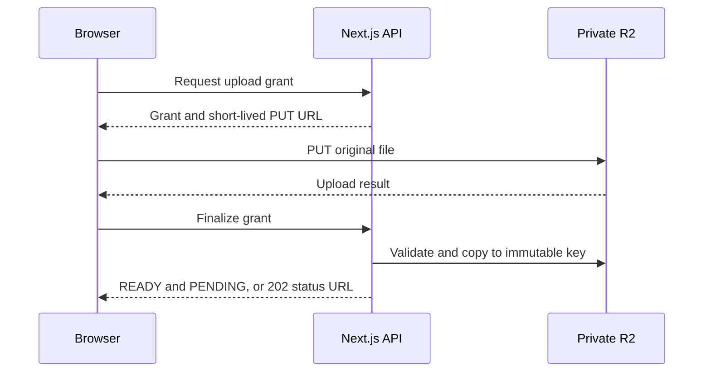

# PlanBridge API Design

> **V1 scope update (22 October 2026):** Email verification is deferred per the PRD. `POST /auth/register` returns 202 with the same generic login instruction for new and existing addresses and queues no email. The UI redirects to login. `POST /auth/verify-email` and `/auth/resend-verification` return 410 `EMAIL_VERIFICATION_DISABLED`. Verification prerequisites and `EMAIL_VERIFICATION_REQUIRED` responses below do not apply in v1; email matching and membership/role checks still apply. Password recovery is unchanged. `emailVerified` remains truthful and is not an access gate.

**Version:** 1.0  
**Date:** 21 October 2026  
**Status:** Proposed implementation contract; endpoints are not implemented or deployed  
**Format:** REST over HTTPS, JSON, TypeScript, Next.js Route Handlers on Node.js  
**Baseline:** PlanBridge Database Design v1; approved PRD and System Design decisions

## 1. Purpose and reading guide

An API is the agreement between the frontend and backend. This document specifies what the frontend sends, what the server returns, who may call each endpoint, and what happens when something fails.

For example: a React task form sends a title to `POST /api/v1/weddings/{weddingId}/tasks`; the backend checks access, saves the task and returns its ID/version. The frontend never sends a database query or connects to MongoDB directly.

This contract covers the planning pilot, commercial planning features and the provisional paid-launch boundary. Implement the pilot first. Do not build every endpoint before testing a real wedding.

The API follows the database design’s corrected behaviour: task progress and approval are separate; only the assigned active admin decides an approval; cancellation preserves financial liability; guests have no accounts; guest reminder sends require an organizer action. No image processing pipeline, native live streaming, WhatsApp integration or public vendor marketplace is added.

## 2. API conventions

### 2.1 Paths, actors and release labels

All application routes start with `/api/v1`. Tables use these abbreviations:

- `W` = `/weddings/{weddingId}`.
- `G` = `/guest/weddings/{weddingId}`.
- `P` = planning pilot; `C` = commercial planning; `B` = paid-launch integration.
- `U` = signed-in user; verified email required for wedding creation/joining and wedding workspace operations.
- `M` = active wedding member: ADMIN or MANAGER.
- `A` = active wedding ADMIN.
- `O` = designated wedding owner, who must also be an ADMIN.
- `R` = currently assigned active admin reviewer.
- `GR`, `GU`, `GG` = valid household RSVP, photo-upload or gallery capability session respectively.
- `Public` = no account/session required; the response is deliberately public.
- `I` = required `Idempotency-Key` header. An unmarked endpoint does not promise application-level replay deduplication.

An ID in a URL is never permission. Every member request resolves current membership and wedding status on the server; nested IDs must belong to that wedding. Guest routes check the matching capability scope and wedding ID. Cross-wedding object lookups return a generic 404.

### 2.2 JSON types and naming

| Item | Contract |
| --- | --- |
| IDs | 24-character hexadecimal ObjectId strings; public property name `id`, not `_id` |
| Instants | ISO 8601 UTC strings, e.g. `2026-11-20T12:30:00Z` |
| Calendar dates | `YYYY-MM-DD`, e.g. weddingDate; do not turn a date-only field into midnight UTC |
| Money | Integer paise as a string: `"5000000"` means ₹50,000; currency is `INR` |
| Byte counts | Nonnegative integer strings |
| Versions | Positive integer numbers |
| Optional response fields | Omitted when absent, except expressly nullable fields such as nextCursor |
| PATCH | Omitted means unchanged; explicit `null` clears only a documented clearable field; server unsets it in storage |
| Arrays | Replacement on PATCH, not automatic append; dedicated batch endpoints have separate semantics |
| Enums | Exact uppercase values; no free-form status strings |

Input objects are strict allowlists. Reject unknown properties, raw MongoDB operators and client-supplied actor IDs, moderation decisions outside approval routes, timestamps, ownership, counters or computed totals. Do not return password hashes, internal token hashes, encrypted secrets, R2 keys, provider payloads, leases or raw database documents.

### 2.3 Success responses

Single resource, HTTP 200 or 201:

```json
{
  "data": {
    "id": "680000000000000000000001",
    "title": "Finalize invitation",
    "version": 1
  },
  "meta": { "requestId": "req_01" }
}
```

List response:

```json
{
  "data": [],
  "page": { "limit": 25, "nextCursor": null, "hasMore": false },
  "meta": { "requestId": "req_02" }
}
```

Async responses use HTTP 202 and return the created job/resource identifiers and a status URL. HTTP 202 means durably accepted, not finished. HTTP 204 has no body. HTTP 201 includes a Location header where there is a retrievable created resource. Every response has `X-Request-Id`; errors and JSON successes also include the request ID in their body.

### 2.4 Errors

```json
{
  "error": {
    "code": "VALIDATION_ERROR",
    "message": "Check the highlighted fields.",
    "fields": [
      { "path": "title", "code": "REQUIRED", "message": "Enter a task title." }
    ]
  },
  "meta": { "requestId": "req_03" }
}
```

`fields` is present for field-level errors; `details` may contain allowlisted contextual values such as currentVersion, never secrets or another wedding’s IDs. Frontend logic uses code, not message wording.

| HTTP | Error codes / meaning |
| --- | --- |
| 400 | INVALID_JSON, INVALID_ID, VALIDATION_ERROR, IDEMPOTENCY_KEY_REQUIRED, VERSION_REQUIRED |
| 401 | AUTH_REQUIRED, SESSION_EXPIRED, INVALID_CREDENTIALS, GUEST_ACCESS_REQUIRED |
| 403 | FORBIDDEN, EMAIL_VERIFICATION_REQUIRED, CSRF_INVALID, GUEST_SCOPE_REQUIRED, ENTITLEMENT_REQUIRED |
| 404 | RESOURCE_NOT_FOUND, SITE_NOT_AVAILABLE; also used to conceal cross-wedding existence |
| 409 | VERSION_CONFLICT, ALREADY_IN_WEDDING, LAST_ADMIN, OWNER_TRANSFER_REQUIRED, REVIEWER_REASSIGNMENT_REQUIRED, APPROVAL_REQUIRED, SUBMISSION_CHANGED, INVALID_TRANSITION, IDEMPOTENCY_KEY_REUSED, REQUEST_IN_PROGRESS, QUOTA_EXCEEDED, RSVP_CLOSED, UPLOADS_CLOSED |
| 410 | LINK_UNAVAILABLE for an invalid/expired/revoked submitted bearer token; generic wording without confirming the wedding |
| 413 | PAYLOAD_TOO_LARGE, FILE_TOO_LARGE |
| 415 | UNSUPPORTED_MEDIA_TYPE |
| 429 | RATE_LIMITED with Retry-After seconds |
| 500 | INTERNAL_ERROR; generic message with request ID |
| 503 | DEPENDENCY_UNAVAILABLE; retry only according to the action’s idempotency rules |

Additional module-specific 409 codes are defined alongside their operations. Unknown errors must not expose stack traces, SQL/Mongo errors or provider credentials.

### 2.5 Pagination, filters and limits

Unless a table overrides ordering, member lists use createdAt descending then id descending; tasks use dueAt ascending then id, with unscheduled tasks requested separately. List endpoints accept `limit` (proposed default 25, maximum 100) and opaque `cursor`. Sort order is fixed per endpoint unless a supported sort is explicitly listed. A cursor binds to wedding, filter and sort; reusing it with different filters returns 400. Use stable timestamp/name plus ID ordering. Counts come from dedicated summary fields/endpoints, not an expensive totalCount on every page.

Proposed request guardrails: JSON bodies up to 256 KiB; batch mutations up to 50 items; task/comment text up to 10,000 characters; title/name up to 200; at most 20 attached media IDs per submission. These are implementation defaults, not agreed customer package quotas. The capabilities endpoint advertises configured effective limits. Larger guest imports use the CSV upload workflow.

### 2.6 Edit conflicts and retries

Every update to an existing versioned resource carries `expectedVersion`. This includes state-changing POST actions. The server compares it before writing and increments version on success. A mismatch returns 409 VERSION_CONFLICT with currentVersion after authorization; the frontend refetches, retains unsaved input and lets the user reconcile. There is no blind automatic overwrite.

For `I` endpoints, generate one random UUID per user action. Reuse it and the exact body if the connection fails. Do not generate another key merely because the first request timed out. Scope keys to authenticated actor/capability, wedding and operation. A changed request under the same key returns 409 IDEMPOTENCY_KEY_REUSED; an active claim returns 409 REQUEST_IN_PROGRESS with Retry-After.

On replay, authenticate and authorize again, then return a completed stored outcome before checking the now-stale expectedVersion. Retain ordinary request keys for a proposed 24-hour API replay window; business records preserve durable payment/import/purchase operation identifiers beyond that window. Once the API window expires, reconcile the affected resource before intentionally repeating an uncertain action. Resend’s provider replay window is separate from this API policy.

For responses containing short-lived upload/read URLs or share links, persist stable resource identifiers, not plaintext secret-bearing bodies. An authorized replay may return newly signed URLs for the same grant/resource within its original validity window; it must not allocate a second upload or create another link.

## 3. Sessions, CSRF and guest access

### 3.1 Member authentication

Use a server-issued `__Host-planbridge-session` cookie with Secure, HttpOnly, SameSite=Lax, Path=/ and no Domain. The frontend never receives the session token as JSON and never stores it in localStorage. Use same-origin API calls with credentials included. Validate session expiry, user status/authVersion and current membership on every protected request.

`GET /auth/csrf` returns `{csrfToken}` and establishes/binds a short-lived anonymous CSRF context before login, or binds to the current member context. Send `X-CSRF-Token` on browser mutations, including login, logout and guest exchange. Validate the exact allowed Origin as well. Rotate the CSRF context after login/reset/logout and refetch it. Cross-origin credentialed CORS is not enabled for arbitrary origins.

Webhooks and internal service routes use signatures/service credentials instead of CSRF cookies. No ordinary GET changes business state. The protected scheduler GET is the explicit Vercel integration exception.

### 3.2 Guest sessions

A guest opens a URL containing a random link token, then the frontend posts it to `/guest/exchange`. A valid exchange sets a short-lived HttpOnly cookie and returns only wedding/scope/context information. This is access through a link, not signup or identity verification.

Use separate cookie slots for RSVP, upload and gallery scopes, e.g. `__Host-planbridge-guest-rsvp`, `__Host-planbridge-guest-upload`, and `__Host-planbridge-guest-gallery`. Only one wedding session per scope is active in a browser at a time for v1. A second wedding’s exchange replaces that scope’s session; old tabs receive GUEST_ACCESS_REQUIRED rather than accessing the wrong wedding. The path’s weddingId must match the session.

`GET G/csrf?scope=HOUSEHOLD_RSVP|PHOTO_UPLOAD|GALLERY` returns the CSRF token bound to that scope session. Guest mutations use it plus Origin checks. Exchange itself uses the anonymous `/auth/csrf` context. Remove capability tokens from the visible URL after exchange; do not log URLs containing them. A token in a URL fragment is recommended so it is not sent in an initial HTTP request/referrer. Account and invitation email scanners must not consume one-use tokens merely by opening a GET page.

### 3.3 Access matrix

| Action | Manager | Admin | Owner | Guest |
| --- | --- | --- | --- | --- |
| Shared events/tasks/vendors/expenses/guests | Yes | Yes | Yes | No |
| Invite/remove members or change roles | No | Yes | Yes | No |
| Submit task/expense for approval | Yes | Yes | Yes | No |
| Decide approval | No | Only assigned reviewer | Only assigned reviewer | No |
| Edit/publish website draft | Yes | Yes | Yes | No |
| Upload gallery photo | Yes | Yes | Yes | Upload capability |
| Approve/reject gallery photo | No | Yes | Yes | No |
| RSVP | Organizer correction | Organizer correction | Organizer correction | Own household capability |
| Billing/ownership/deletion | No | No, unless owner | Yes | No |

Read permission never implies approval permission. “Admin” does not bypass submission-version, assigned-reviewer or tenant checks.

## 4. DTOs: the frontend’s data shapes

A DTO is the JSON shape returned to the frontend. It deliberately differs from the raw database record. Mutable DTOs include `id`, `version`, `createdAt`, `updatedAt`; wedding-owned member DTOs also include `weddingId`. Immutable records omit version/updatedAt. Global account DTOs have no weddingId. Guest DTOs omit internal actor/account details. Server-computed fields are read-only.

| DTO | Public fields beyond standard identity/version fields |
| --- | --- |
| User | displayName, email, emailVerified, notificationPreferences |
| Wedding | brideName, groomName, weddingDate?, timeZone, slug, status, ownerUserId, currency, budgetPaise?, settings; entitlement summary |
| Membership | userId, displayName, role, status, joinedAt; do not expose account security fields |
| MemberInvite | recipientEmail, role, status, expiresAt, acceptedAt?; no raw token |
| Event | name, description?, startsAt?, endsAt?, venue?, status, publicSchedule, internalNotes?; internalNotes only in member DTO |
| Task | title, description?, eventId?, assigneeUserId?, priority, dueAt?, progress, approvalRequired, contentRevision, attachmentMediaIds, approvalSummary? |
| Approval | subjectType, subjectId, subjectRevision, submissionNumber, snapshot, assignedAdminUserId, submittedByUserId, status, decision? |
| Comment | taskId, body, attachmentMediaIds, author summary, editedAt?, deletedAt? |
| Vendor | name, category, contactName?, email?, phone?, notes?, bookingStatus, eventIds, documentMediaIds, archivedAt? |
| Expense | title, category, description?, vendorId?, eventId?, estimatePaise?, approvalRequired, contentRevision, proposedCommitment?, effectiveCommitment?, cancellationSettlement?, settlementPending, currency, status, attachmentMediaIds, totals |
| Installment | expenseId, label, amountPaise, dueAt, status, sequence, allocatedPaise, unpaidPaise, overdue |
| PaymentEntry | expenseId, kind, amountPaise, paidAt, payer, method, reference?, receiptMediaId?, allocations, originalPaymentId?, reversesEntryId?, reason?, recordedByUserId |
| Household | label, primaryContact, side?, group?, remindersOptOut, archivedAt? |
| Guest | householdId, displayName, isPlaceholder, ageGroup, dietaryNotes?, archivedAt? |
| EventGuest | eventId, guestId, invitationStatus, rsvp, respondedAt?, respondedBy summary |
| GuestLink | kind, householdId?, status, expiresAt?, accessVersion; URL only from explicit share/create/rotate actions |
| Media | purpose, state, moderation, originalFilename, contentType?, sizeBytes?, eventId?, accessVersion, reviewedAt?, rejectionReason? |
| Site | draft, draftRevision, publishedRevision?, isPublished, publishedAt? |
| EmailJob | kind, recipient display/contact, state, deliveryStatus, acceptedAt?, lastErrorCode?, retryAllowed; no provider payload or link secrets |

`approvalSummary` is `{requestId, status, subjectRevision, assignedAdminUserId, isCurrent}`. The UI may show “Waiting for approval” from this value while task.progress remains IN_PROGRESS. Expense totals are `{netPaidPaise, liabilityPaise?, outstandingPaise?, provisional}`; an unknown liability is omitted, not shown as zero.

## 5. Accounts and onboarding — P

Table inputs use `?` for optional fields. Success values name the DTO or response data object inside the common envelope.

| Method / path | Actor | Request | Success |
| --- | --- | --- | --- |
| GET /auth/csrf | Public/U | None | 200 {csrfToken} |
| POST /auth/register | Public | {displayName, email, password} | 202 {message: generic check-email instruction} |
| POST /auth/login | Public | {email, password} | 200 {user: User, activeWeddingId?}; Set-Cookie |
| POST /auth/logout | U or expired cookie | Empty object | 204; revoke current session and clear cookie |
| POST /auth/verify-email | Public | {token} | 200 {verified: true}; no auto-login |
| POST /auth/resend-verification | Public | {email} | 202 generic message |
| POST /auth/forgot-password | Public | {email} | 202 generic message |
| POST /auth/reset-password | Public | {token, newPassword} | 200 {reset: true}; revoke sessions; require login |
| GET /me | U | None | 200 {user: User, activeMembership?, activeWeddingId?} |
| PATCH /me | U | {expectedVersion, displayName?, notificationPreferences?} | 200 User |
| POST /me/change-password | U | {currentPassword, newPassword} | 200 {changed: true}; rotate current session, revoke others |
| POST /me/email-change-requests | U | {currentPassword, newEmail} | 202 generic message; verify new email before replacement |
| POST /auth/confirm-email-change | Public | {token} | 200 {changed: true}; revoke sessions |
| GET /me/sessions | U | Pagination | 200 list of {id, createdAt, lastSeenAt?, isCurrent}; no tokens |
| POST /me/sessions/{sessionId}/revoke | U | Empty object | 204; only own session |
| POST /me/sessions/revoke-others | U | {currentPassword} | 204 |

Registration for an existing email must not overwrite the account. Registration, verification resend and password recovery use generic responses and limits to reduce account enumeration. Failed login returns INVALID_CREDENTIALS without distinguishing missing account from wrong password. Logged-in unverified users can access `/me` and verification/account actions, but wedding operations return EMAIL_VERIFICATION_REQUIRED.

Password policy, session lifetime and token expiry are validated server configuration. Do not silently truncate passwords. Reject invalid/consumed one-use tokens with a generic LINK_UNAVAILABLE. Password/security messages are distinct from optional planning reminders.

## 6. Wedding, permissions and members — P

| Method / path | Actor | Request / filters | Success |
| --- | --- | --- | --- |
| POST /weddings | U; I | {brideName, groomName, weddingDate?, timeZone, budgetPaise?} | 201 Wedding plus membership ADMIN |
| GET W | M | None | 200 Wedding |
| PATCH W | M | {expectedVersion, brideName?, groomName?, weddingDate?, timeZone?, budgetPaise?, settings?} | 200 Wedding |
| GET W/capabilities | M | None | 200 {permissions, limits, featureAvailability} |
| GET W/dashboard | M | None | 200 dashboard summary |
| GET W/members | M | status?; pagination | 200 Membership list |
| POST W/member-invites | A; I | {email, role} | 201 {invite: MemberInvite, emailJobId} |
| GET W/member-invites | A | status?; pagination | 200 MemberInvite list |
| POST W/member-invites/{inviteId}/resend | A; I | {expectedVersion} | 202 {invite, emailJobId}; rotate token, invalidate old token |
| POST W/member-invites/{inviteId}/revoke | A | {expectedVersion} | 200 MemberInvite |
| POST /member-invites/inspect | Public | {token} | 200 {weddingLabel, role, recipientEmailMasked, expiresAt} |
| POST /member-invites/accept | U; I | {token} | 200 {membership, weddingId} |
| PATCH W/members/{membershipId} | A | {expectedVersion, role} | 200 Membership |
| POST W/members/{membershipId}/remove | A | {expectedVersion, reason?} | 200 Membership |
| POST W/membership/leave | M | {expectedVersion} of own membership | 204 |
| POST W/ownership-transfer | O; I | {expectedVersion, newOwnerUserId, currentPassword} | 200 Wedding |
| POST W/archive | O | {expectedVersion} | 200 Wedding |
| POST W/restore | O | {expectedVersion} | 200 Wedding |

Create wedding atomically creates the owner ADMIN membership and usage record. When the site module is enabled, also initialize an empty versioned weddingSites draft; backfill that row for pilot weddings before enabling site uploads. No account may have two active memberships. The server generates the unique names/date/suffix slug; it is not client-writable and does not automatically change with a date edit. URL renaming is deferred.

An invitation creates one pending membership offer and queues email; it does not immediately add the recipient. Only the intended verified email can accept. A still-pending invite for that wedding/email returns 409 INVITE_ALREADY_PENDING; the UI uses resend/revoke instead. Accepting an invite for another wedding returns ALREADY_IN_WEDDING.

Role changes/removal/leave preserve at least one admin and a valid owner. Outstanding reviewer assignments must be reassigned first; otherwise REVIEWER_REASSIGNMENT_REQUIRED. Owner transfer targets an existing active admin. Transferring ownership does not remove the old owner’s admin membership.

`settings.galleryPublished` is admin-only because it controls gallery publication; other planning settings, including RSVP/upload closing dates, remain editable by both member roles. Reject an entire mixed PATCH if it includes an unauthorized field. Slug, owner, entitlement and roles are never writable through ordinary PATCH W.

Recommended lifecycle default: ARCHIVED weddings are read-only for members; public website/gallery, RSVP and upload access are suspended. Restore re-enables access only if still permitted by entitlements, links and closing dates. Package-expiry guest access duration remains a commercial decision and must be configured explicitly before sale.

Example capability response:

```json
{
  "data": {
    "permissions": {
      "manageMembers": false,
      "editPlanning": true,
      "moderatePhotos": false,
      "manageBilling": false
    },
    "limits": {
      "maxPageSize": 100,
      "maxBatchItems": 50
    },
    "featureAvailability": {
      "planning": "ENABLED",
      "guestUploads": "NOT_CONFIGURED"
    }
  },
  "meta": { "requestId": "req_caps" }
}
```

These flags help render the UI; every endpoint independently enforces the same rules. File/storage/email quota values appear when configured; missing configuration disables the affected operation instead of implying unlimited usage.

Dashboard data contains `asOf`, `tasks:{open, overdue, unassigned}`, `approvals:{awaiting, assignedToMe}`, and bounded upcomingEvents. C adds finance summary, per-event attendance and moderation counts visible according to role. These are computed summaries, not editable records.

## 7. Events — P

| Method / path | Actor | Request / filters | Success |
| --- | --- | --- | --- |
| GET W/events | M | status?; startsAt ascending then id | 200 Event list |
| POST W/events | M; I | {name, description?, startsAt?, endsAt?, venue?, publicSchedule?, internalNotes?} | 201 Event |
| GET W/events/{eventId} | M | None | 200 Event |
| PATCH W/events/{eventId} | M | {expectedVersion, editable event fields} | 200 Event |
| POST W/events/{eventId}/cancel | M | {expectedVersion, reason?} | 200 Event |
| POST W/events/{eventId}/restore | M | {expectedVersion} | 200 Event |

Venue is `{name?, address?, mapUrl?}` with allowed HTTPS links. Dates may be absent during planning; if both are present, end must follow start. Clearing dates/venue/internal notes uses null. Cancellation excludes the event from guest attendance and reminders but preserves tasks, invitations and history. It does not silently cancel financial liabilities or send email. Event edits do not reset RSVP; show affected guests and offer an explicit update send.

## 8. Tasks, comments and approvals — P

### 8.1 Task endpoints

| Method / path | Actor | Request / filters | Success |
| --- | --- | --- | --- |
| GET W/tasks | M | progress?, assigneeUserId?, eventId?, approvalStatus?, dueBefore?, unscheduled?; pagination | 200 Task list |
| POST W/tasks | M; I | {title, description?, eventId?, assigneeUserId?, priority?, dueAt?, approvalRequired?, attachmentMediaIds?} | 201 Task |
| GET W/tasks/{taskId} | M | None | 200 Task |
| PATCH W/tasks/{taskId} | M | {expectedVersion, editable task fields, reason?} | 200 Task |
| GET W/tasks/{taskId}/comments | M | Pagination, createdAt ascending | 200 Comment list |
| POST W/tasks/{taskId}/comments | M; I | {body, attachmentMediaIds?} | 201 Comment |
| PATCH W/tasks/{taskId}/comments/{commentId} | Author | {expectedVersion, body, attachmentMediaIds?} | 200 Comment |
| POST W/tasks/{taskId}/comments/{commentId}/redact | Author/A | {expectedVersion, reason} | 200 Comment tombstone |

Editable task fields: title, description, eventId, assigneeUserId, priority, dueAt, progress, approvalRequired, attachmentMediaIds. Defaults: TODO, NORMAL, approvalRequired=false, empty attachments. Optional description/event/assignee/dueAt can be cleared with null. The server determines contentRevision; the client cannot set it.

Task progress is TODO / IN_PROGRESS / DONE / CANCELLED. Setting DONE checks current approval when required. Editing approved scope/files reopens DONE work to IN_PROGRESS and invalidates its current approval eligibility; response returns the resulting progress and approvalSummary. A due-date/assignee-only change retains approval. Disabling approvalRequired after submission history requires admin plus reason. Reopening a cancelled task is an explicit progress edit, with its previous approval applicability rechecked.

### 8.2 Approval endpoints

| Method / path | Actor | Request / filters | Success |
| --- | --- | --- | --- |
| POST W/tasks/{taskId}/submissions | M; I | {expectedVersion, assignedAdminUserId} | 201 {approval: Approval, task: Task} |
| GET W/approvals | M | status?, subjectType?, subjectId?, assignedAdminUserId?; submittedAt ascending | 200 Approval list |
| GET W/approvals/{approvalId} | M | None | 200 Approval |
| POST W/approvals/{approvalId}/decisions | R; I | {expectedVersion, decision, reason?} | 200 {approval, subject} |
| POST W/approvals/{approvalId}/reassign | A | {expectedVersion, assignedAdminUserId, reason} | 200 Approval |
| POST W/approvals/{approvalId}/withdraw | Submitter/A | {expectedVersion, reason?} | 200 Approval |

`decision` is APPROVED or CHANGES_REQUESTED; changes requested requires a reason. The server snapshots current saved task/expense content and immutable media IDs on submission. A new submission supersedes the previous AWAITING request. `subject` returns the updated Task or Expense DTO, discriminated by approval.subjectType.

A decision checks both the approval version and the subject content revision atomically. A stale revision returns SUBMISSION_CHANGED. Any active admin may reassign, but only the assigned reviewer can decide. Withdrawing applies only to AWAITING; a final decision cannot be overwritten. Approval never automatically changes task progress to DONE.

### 8.3 Create-task example

```http
POST /api/v1/weddings/680000000000000000000010/tasks
Content-Type: application/json
X-CSRF-Token: <csrf-token>
Idempotency-Key: 0f4d2577-ef9e-4216-b942-48eaf1d1364b
```

```json
{
  "title": "Finalize invitation and arrange printing",
  "description": "Approve the design before placing the print order.",
  "assigneeUserId": "680000000000000000000030",
  "priority": "HIGH",
  "dueAt": "2026-11-20T12:30:00Z",
  "approvalRequired": true
}
```

HTTP 201:

```json
{
  "data": {
    "id": "680000000000000000000001",
    "weddingId": "680000000000000000000010",
    "title": "Finalize invitation and arrange printing",
    "description": "Approve the design before placing the print order.",
    "assigneeUserId": "680000000000000000000030",
    "priority": "HIGH",
    "dueAt": "2026-11-20T12:30:00Z",
    "progress": "TODO",
    "approvalRequired": true,
    "attachmentMediaIds": [],
    "contentRevision": 1,
    "version": 1,
    "createdAt": "2026-10-21T10:00:00Z",
    "updatedAt": "2026-10-21T10:00:00Z"
  },
  "meta": { "requestId": "req_task_create" }
}
```

The form stores data.version and sends it as expectedVersion when editing.

## 9. Vendors and finances — C

### 9.1 Vendor and expense endpoints

| Method / path | Actor | Request / filters | Success |
| --- | --- | --- | --- |
| GET W/vendors | M | bookingStatus?, archived?; name ascending | 200 Vendor list |
| POST W/vendors | M; I | {name, category, contactName?, email?, phone?, notes?, bookingStatus?, eventIds?, documentMediaIds?} | 201 Vendor |
| GET W/vendors/{vendorId} | M | None | 200 Vendor |
| PATCH W/vendors/{vendorId} | M | {expectedVersion, editable vendor fields} | 200 Vendor |
| POST W/vendors/{vendorId}/archive | M | {expectedVersion} | 200 Vendor |
| POST W/vendors/{vendorId}/restore | M | {expectedVersion} | 200 Vendor |
| GET W/expenses | M | status?, vendorId?, eventId?, category?; createdAt descending | 200 Expense list |
| POST W/expenses | M; I | {title, category, description?, vendorId?, eventId?, estimatePaise?, approvalRequired?, attachmentMediaIds?} | 201 Expense |
| GET W/expenses/{expenseId} | M | None | 200 Expense |
| PATCH W/expenses/{expenseId} | M | {expectedVersion, title?, category?, description?, vendorId?, eventId?, estimatePaise?, approvalRequired?, attachmentMediaIds?} | 200 Expense |
| POST W/expenses/{expenseId}/proposals | M; I | {expectedVersion, amountPaise, scope} | 200 Expense with proposedCommitment |
| POST W/expenses/{expenseId}/submissions | M; I | {expectedVersion, assignedAdminUserId} | 201 {approval, expense} |
| POST W/expenses/{expenseId}/accept-commitment | M; I | {expectedVersion} | 200 Expense; only if approvalRequired=false |
| POST W/expenses/{expenseId}/cancel | M; I | {expectedVersion, reason, finalLiabilityPaise? , settlementPending} | 200 Expense |
| POST W/expenses/{expenseId}/settlement | M; I | {expectedVersion, finalLiabilityPaise, reason} | 200 Expense; cancelled expense only |
| GET W/finance-summary | M | None | 200 computed finance summary |

Ordinary expense PATCH cannot set effectiveCommitment, paid totals, approval state or cancellation liability. A proposal holds a requested amount/scope. For approvalRequired=true, admin approval of its exact revision becomes the effective commitment. For uncontrolled commitments, explicit accept-commitment performs that action. Preserve the previous effective commitment while a replacement proposal awaits approval.

If cancel.settlementPending=false, finalLiabilityPaise is required (zero is allowed). If true, finalLiabilityPaise is omitted and previous accepted liability remains visibly provisional; if none exists, liability is unknown rather than invented. Settlement finalises it later. Cancelling a vendor does not automatically cancel expenses. Cancellation does not delete installments; mark obsolete schedules CANCELLED explicitly and create/update settlement installments as needed. Summary must flag inconsistent schedules.

Finance summary fields: currency, budgetPaise?, activeCommittedPaise, cancellationLiabilityPaise, provisionalLiabilityPaise, unknownSettlementCount, forecastPaise, netPaidPaise, outstandingPaise, forecastRemainingPaise?, overdueInstallmentsPaise, provisional. Values that exclude unknown liabilities must be labelled provisional. Full forecast includes cancellation exposure. Negative outstanding/remaining values are valid.

### 9.2 Installments and payment records

| Method / path | Actor | Request / filters | Success |
| --- | --- | --- | --- |
| GET W/expenses/{expenseId}/installments | M | Pagination | 200 Installment list |
| POST W/expenses/{expenseId}/installments | M; I | {label, amountPaise, dueAt, sequence} | 201 Installment |
| PATCH W/expenses/{expenseId}/installments/{installmentId} | M | {expectedVersion, label?, amountPaise?, dueAt?, sequence?, status?} | 200 Installment |
| GET W/expenses/{expenseId}/payments | M | paidAt descending | 200 PaymentEntry list |
| POST W/expenses/{expenseId}/payments | M; I | PaymentInput | 201 {entry: PaymentEntry, expenseVersion, totals} |
| POST W/expenses/{expenseId}/payments/{paymentId}/refunds | M; I | RefundInput | 201 {entry, expenseVersion, totals} |
| POST W/expenses/{expenseId}/payments/{paymentId}/reversals | M; I | {reason} | 201 {entry, expenseVersion, totals} |
| POST W/expenses/{expenseId}/payments/{paymentId}/corrections | M; I | {reason, replacement: PaymentInput} | 201 {reversal, replacement, expenseVersion, totals} |

PaymentInput: `{amountPaise, paidAt, payer:{displayName,userId?}, method, reference?, receiptMediaId?, allocations?:[{installmentId,amountPaise}]}`. Method is CASH / BANK_TRANSFER / UPI / CARD / OTHER. The server sets kind=PAYMENT and derives a durable operationKey from actor, operation and Idempotency-Key. Reversal/replacement entries in a correction get deterministic distinct subkeys.

RefundInput uses amountPaise, paidAt, payer, method, reference?, receiptMediaId?, allocations?, reason. Original payment is identified by the URL. Server validates remaining refundable amount/allocation. Reversal copies the original entry’s amount and allocations with opposite ledger effect; the client cannot choose them. Correction applies only to a PAYMENT and atomically reverses it and creates its replacement. There is no PATCH/DELETE payment endpoint. To correct a refund, reverse that refund and record a new refund after constraints are rechecked.

Payment writes deliberately omit expectedVersion: they append entries and serialize/check the expense ledger within a transaction. Retries use the mandatory idempotency key. Errors include REFUND_EXCEEDS_PAYMENT, PAYMENT_HAS_ACTIVE_REFUNDS, ENTRY_ALREADY_REVERSED, INVALID_ALLOCATION, INSTALLMENT_BELOW_ALLOCATED and REVERSAL_NOT_ALLOWED. An allocated installment cannot belong to another expense. Unallocated payments count toward net paid but do not clear an installment’s overdue balance.

Example payment body:

```json
{
  "amountPaise": "5000000",
  "paidAt": "2026-11-01T06:30:00Z",
  "payer": { "displayName": "Bride's father" },
  "method": "UPI",
  "reference": "Manual transaction reference",
  "allocations": [
    { "installmentId": "680000000000000000000040", "amountPaise": "5000000" }
  ]
}
```

This records ₹50,000. It does not initiate a bank/UPI payment. Calculate money using integer strings/BigInt or an exact money library; ordinary floating-point rupee arithmetic is unsuitable for the ledger.

## 10. Organizer guest management — C

### 10.1 Households, people and event eligibility

| Method / path | Actor | Request / filters | Success |
| --- | --- | --- | --- |
| GET W/households | M | side?, group?, archived?; label ascending | 200 Household list |
| POST W/households | M; I | {label, primaryContact?, side?, group?} | 201 Household |
| GET W/households/{householdId} | M | None | 200 Household |
| PATCH W/households/{householdId} | M | {expectedVersion, label?, primaryContact?, side?, group?, remindersOptOut?} | 200 Household |
| POST W/households/{householdId}/archive | M | {expectedVersion} | 200 Household; revoke its RSVP links, exclude its guests from active counts |
| POST W/households/{householdId}/restore | M | {expectedVersion} | 200 Household; links remain revoked |
| GET W/guests | M | householdId?, ageGroup?, archived?; id ascending | 200 Guest list |
| POST W/guests | M; I | {householdId, displayName, isPlaceholder?, ageGroup?, dietaryNotes?} | 201 Guest |
| GET W/guests/{guestId} | M | None | 200 Guest |
| PATCH W/guests/{guestId} | M | {expectedVersion, displayName?, isPlaceholder?, ageGroup?, dietaryNotes?} | 200 Guest |
| POST W/guests/{guestId}/move-household | M; I | {expectedVersion, householdId} | 200 Guest; revoke affected households' RSVP links |
| POST W/guests/{guestId}/archive | M | {expectedVersion} | 200 Guest |
| POST W/guests/{guestId}/restore | M | {expectedVersion} | 200 Guest |
| GET W/event-guests | M | eventId?, guestId?, householdId?, invitationStatus?, rsvp?; id ascending | 200 EventGuest list |
| POST W/events/{eventId}/invitations/batch | M; I | {items:[{guestId, invitationStatus, expectedVersion?}]} | 200 {items: EventGuest[]} |
| PATCH W/event-guests/{eventGuestId}/rsvp | M | {expectedVersion, rsvp, reason?} | 200 EventGuest with member attribution |
| GET W/events/{eventId}/attendance | M | None | 200 counts by RSVP and ageGroup, asOf |

Household primaryContact is `{name?, email?, phone?}`. No email is required to create guests. AgeGroup is ADULT / CHILD / UNKNOWN; default UNKNOWN. Placeholder slots count as people. No separate editable household headcount exists.

Invitation batch is atomic up to maxBatchItems. Omit expectedVersion only when creating a new guest/event pair; if a row already exists, return 409 and require its current version rather than reset it blindly. Existing rows require expectedVersion. REMOVED rows retain history; reinviting resets RSVP to NO_RESPONSE. Duplicate guest IDs in a request are invalid. A household/guest archived state is checked dynamically so counts and access stop immediately without updating every eventGuest row at once.

Guest names are not unique. Create/merge behaviour must not assume two people with the same name are the same person. Restoring an archived household/guest may reveal still-active invitations; the UI must review them before sending links again. Moving a guest is a deliberate action because it changes who can answer on their behalf.

### 10.2 CSV import and export

| Method / path | Actor | Request | Success |
| --- | --- | --- | --- |
| GET W/guest-import-template | M | None | 200 text/csv with documented columns |
| POST W/guest-imports | M; I | {sourceMediaId, mapping} | 202 {importId, status, statusUrl}; validate/preview only |
| GET W/guest-imports/{importId} | M | None | 200 {id, version, status, rowCount, validCount, committedCount, summary} |
| GET W/guest-imports/{importId}/rows | M | status?; pagination | 200 rows with normalized data/errors/warnings |
| PATCH W/guest-imports/{importId}/rows/{rowId} | M | {expectedVersion, normalizedData?, skip?} | 200 preview row; PREVIEW only |
| POST W/guest-imports/{importId}/commit | M; I | {expectedVersion} | 202 import summary/statusUrl |
| POST W/guest-imports/{importId}/cancel | M | {expectedVersion} | 200 import summary |
| GET W/guest-export | M | format=csv; eventId? | 200 text/csv stream with attachment filename |

CSV columns: householdKey, householdLabel, contactName, email, phone, side, group, guestName, isPlaceholder, ageGroup, dietaryNotes, eventIds. eventIds is an explicitly documented delimited list of known wedding event IDs; preview resolves their display names. Client mapping maps source headers to this allowlist. No automatic name-based merges; duplicate warnings require organizer review.

Imports use IMPORT_SOURCE uploads and never write guests before commit. Recommended addition: an initial VALIDATING state before PREVIEW to represent asynchronous parsing; see section 19. Commit processes bounded idempotent chunks. Invalid non-skipped rows prevent starting commit. Cancellation stops remaining chunks but does not erase already committed rows; return committedCount. Corrections require a new operation or explicit record edits.

Export includes guest ID, household, allowed contact fields, event invitation and RSVP. Escape spreadsheet formula prefixes. For datasets exceeding configured synchronous export limits, return EXPORT_TOO_LARGE (409) with the supported narrowing filters; a durable async export service is a later extension, not an undocumented job type.

## 11. Guest links, RSVP and guest-facing pages — C

### 11.1 Link administration

| Method / path | Actor | Request | Success |
| --- | --- | --- | --- |
| GET W/guest-links | M | kind?, householdId?, status?; pagination | 200 GuestLink metadata list |
| POST W/guest-links | M for RSVP; A for upload/gallery; I | {kind, householdId?, expiresAt?} | 201 {link: GuestLink, shareUrl} |
| POST W/guest-links/{linkId}/share | M for RSVP; A for upload/gallery | Empty object | 200 {shareUrl}; no-store |
| POST W/guest-links/{linkId}/rotate | M for RSVP; A for upload/gallery; I | {expectedVersion} | 200 {link, shareUrl}; invalidate prior token/sessions |
| POST W/guest-links/{linkId}/revoke | M for RSVP; A for upload/gallery | {expectedVersion} | 200 GuestLink |
| POST /guest/exchange | Public | {token, kind} | 200 {weddingId, scope, expiresAt}; scoped Set-Cookie |
| GET G/csrf | GR/GU/GG | scope query | 200 {csrfToken} |
| POST G/logout | Matching guest scope | {scope} | 204; clears that guest session |

Kinds: HOUSEHOLD_RSVP, PHOTO_UPLOAD, GALLERY. householdId is required only for RSVP. Proposed v1 policy: one active link per wedding/kind/household; create returns LINK_ALREADY_ACTIVE if one exists. Rotation modifies the existing link’s token/accessVersion. This constraint requires an index addition noted in section 19.

A downloadable QR can be generated in the frontend from the upload shareUrl; no separate QR-storage API is necessary. Creating, sharing or rotating links is never an automatic email send. The gallery remains available to anyone holding its valid link, not just verified invitees.

### 11.2 Public website versus scoped guest data

| Method / path | Actor | Request | Success |
| --- | --- | --- | --- |
| GET /public/weddings/{slug} | Public | None | 200 PublishedSite public projection |
| GET /public/weddings/{slug}/media/{mediaId}/access | Public | None | 200 {url, expiresAt}; published site asset only |
| GET G/context | GR/GU/GG | scope query | 200 safe wedding display, scope, relevant availability/limits |
| GET G/schedule | GR | Pagination | 200 invited published event projections only |
| GET G/rsvp | GR | Pagination | 200 household’s individual invitation rows and display names |
| PATCH G/rsvp | GR; I | {responses:[{eventGuestId, expectedVersion, rsvp}]} | 200 {responses: GuestRsvpRow[]} |
| PATCH G/reminder-preferences | GR | {expectedVersion, remindersOptOut} | 200 {remindersOptOut, version} |
| GET G/gallery | GG | Cursor pagination | 200 approved MediaGuest projections; no uploader account details |
| GET G/gallery/{mediaId}/access | GG | None | 200 {url, expiresAt} |

Public PublishedSite includes names, welcomeText, themeId, weddingDate?, deliberately public schedule, permitted venue links and published asset IDs. No private event IDs, household responses or invitation tokens appear. A public generic site does not mint a gallery capability for any visitor; the shared gallery URL carries its own capability.

GR schedule and RSVP responses show only events actually assigned to that household; they do not include unrelated public events merely because the generic site includes them. RSVP rows expose `{id, version, guest:{id,displayName,ageGroup}, event:{id,name,startsAt?}, rsvp}` and no other household’s data. Dietary notes are omitted from public/common site responses.

RSVP batch is atomic and bounded. Valid guest values are ACCEPTED or DECLINED. Omitted rows are untouched; an organizer may explicitly reset a row to NO_RESPONSE. The server derives household/actor from the session, rejects substituted IDs and requires active invitations/guest/event/wedding, an available published guest site and an open RSVP window. Old versions return VERSION_CONFLICT without saving a partial batch. Editing a response does not create another attendee.

```json
{
  "responses": [
    {
      "eventGuestId": "680000000000000000000051",
      "expectedVersion": 1,
      "rsvp": "ACCEPTED"
    },
    {
      "eventGuestId": "680000000000000000000052",
      "expectedVersion": 2,
      "rsvp": "DECLINED"
    }
  ]
}
```

## 12. Wedding website authoring — C

| Method / path | Actor | Request | Success |
| --- | --- | --- | --- |
| GET /site-themes | Public | None | 200 array of three theme codes/names/preview metadata |
| GET W/site | M | None | 200 Site |
| PATCH W/site/draft | M | {expectedVersion, draft: SiteContentInput} | 200 Site; increment draftRevision |
| POST W/site/preview | M | {audience: PUBLIC or HOUSEHOLD, householdId?} | 200 projected draft preview with preview=true |
| POST W/site/publish | M; I | {expectedVersion, expectedDraftRevision} | 200 Site |
| POST W/site/unpublish | M | {expectedVersion} | 200 Site |

SiteContentInput is a bounded complete draft: `{themeId, welcomeText, brideName, groomName, weddingDate?, coverMediaId?, invitationMediaId?, eventIds}`. Server builds schedule snapshots from scoped event records and allows only published common or household-eligible fields. Missing optional properties in this complete replacement clear them. themeId must be one of the known three codes; switching themes preserves other content in the frontend’s submitted draft.

Public preview includes only event snapshots flagged publicSchedule; household preview intersects the selected household’s invitations. Snapshot entries retain server-controlled audience flags. On publish, cover/invitation media must be READY with the correct purpose and explicit intent to publish. A gallery photo cannot bypass moderation by being attached as a SITE_ASSET; require purpose-consistent media and a separate valid upload if repurposing is needed.

Changing draft does not affect published output. Publishing does not send invitations. Unpublishing blocks site/guest schedule/RSVP and public assets; gallery access also requires site publication plus galleryPublished. Upload access remains independently controlled by its link, upload window, entitlement and wedding status, so organizers may collect photos before publishing the site. These are explicit v1 defaults.

## 13. Uploads, photo moderation and private media

Private task attachments are P; gallery and other commercial purposes are C. File bytes go directly to R2 via short-lived upload URLs. API requests create grants and finalize metadata; they do not stream large image bodies through Vercel.

### 13.1 Member and guest upload endpoints

| Method / path | Actor | Request | Success |
| --- | --- | --- | --- |
| POST W/media/upload-grants | M; I | UploadInput | 201 UploadGrantResponse |
| GET W/media/{mediaId} | M | None | 200 Media; scoped metadata |
| POST W/media/{mediaId}/finalize | M; I | {uploadGrantId} | 200 Media if finalized; 202 {mediaId,statusUrl} if processing |
| GET W/media | M | purpose?, state?, moderation?, eventId?; createdAt descending | 200 Media list |
| POST W/media/{mediaId}/access | M | Empty object | 200 {url, expiresAt}; permission-checked bytes |
| POST W/media/{mediaId}/delete | M for allowed private attachments; A for gallery; I | {expectedVersion, reason?} | 202 {mediaId,state: DELETE_PENDING,statusUrl} |
| POST W/media/{mediaId}/moderation | A; I | {expectedVersion, decision, reason?} | 200 Media |
| POST W/media/moderation-batches | A; I | {items:[{mediaId,expectedVersion,decision,reason?}]} | 200 per-item result array |
| POST G/uploads | GU; I | {filename, contentType, sizeBytes, eventId?, displayName?} | 201 UploadGrantResponse |
| POST G/uploads/{mediaId}/finalize | GU; I | {uploadGrantId} | 200 safe upload status or 202 statusUrl |
| GET G/uploads/{mediaId} | GU | None | 200 own-upload status only |

UploadInput: `{purpose, filename, contentType, sizeBytes, parent?:{type,id}, eventId?}`. Parent rules: TASK_ATTACHMENT→TASK; RECEIPT→EXPENSE; VENDOR_DOCUMENT→VENDOR; SITE_ASSET/INVITATION→SITE. GALLERY_PHOTO and IMPORT_SOURCE do not require a parent at grant time. Purpose and parent become immutable. A referenced parent must already exist; create the task/expense/site draft before attaching files. Guest upload purpose is always GALLERY_PHOTO and cannot be supplied by the guest.

UploadGrantResponse contains `{mediaId, uploadGrantId, upload:{method:"PUT",url,headers,expiresAt}, finalizeUrl, statusUrl}`. All URL responses use private, no-store. Member grants may be finalized by an authorized member for that wedding; guest finalize/status additionally require the exact originating guest session (see schema addition in section 19). A shared upload link must not allow one visitor to enumerate another visitor’s pending uploads.

After a direct PUT succeeds, call finalize. The server checks actual size/type and source version, copies verified bytes to an immutable final key, then commits READY plus quota usage. Gallery images become moderation=PENDING, even when uploaded by an admin. A retry cannot create a second file/usage charge. A 202 response is recoverable through the persisted grant and scheduled recovery processor; poll statusUrl. A READY upload means stored, not gallery-approved.

If the upload link has been revoked, finalization is denied and the grant is cleaned up later. The already-issued R2 URL may technically accept bytes until its expiry; those bytes must never be promoted or published without a valid final authorization check. Short URL expiry and cleanup limit this residual window.

### 13.2 Moderation and deletion

Moderation decision is APPROVED or REJECTED; rejection requires reason. Only READY GALLERY_PHOTO records are eligible. Rejecting an approved image removes its future gallery access; accessVersion changes. A batch returns one result per input item and explicitly allows partial success:

```json
{
  "data": {
    "results": [
      { "mediaId": "680000000000000000000061", "ok": true, "version": 3, "moderation": "APPROVED" },
      { "mediaId": "680000000000000000000062", "ok": false, "error": { "code": "VERSION_CONFLICT", "message": "Refresh this photo before deciding." } }
    ]
  },
  "meta": { "requestId": "req_moderation_batch" }
}
```

Store/replay the batch result using its idempotency key; retrying that key does not reapply already successful items. Each item is authorized and processed atomically with its own activity entry. A top-level 200 does not mean every image succeeded.

Managers may see pending moderation metadata, but only admins can read pending gallery image bytes for review; approved gallery bytes may be read by authorized members. Guest upload status never returns pending bytes or other uploaders’ identities. No generic guest DELETE or list-pending endpoint exists.

Private-file deletion is allowed to the uploader or admin only when it will not break immutable submissions, receipt history or published content. Otherwise return MEDIA_IN_USE; detach or supersede through the owning workflow first. Whole-wedding lifecycle deletion is handled separately. No URL or R2 key mutation endpoint exists.

### 13.3 Delivery scopes and cache behaviour

The media gateway receives a signed short-lived capability and performs a current authorization check before using a cached copy. Supported read scopes:

- MEMBER: current member/session and purpose-specific access.
- GALLERY: active gallery link/session, published gallery/site, READY + APPROVED image.
- PUBLIC_SITE: asset explicitly referenced by the current published site revision; never a guest gallery image or private attachment.

The public-site media scope is a necessary completion of the earlier design: published cover/invitation files need read access without making the R2 bucket public. Unpublish/revision changes revoke subsequent access. Client responses are private/no-store; the Worker’s internal byte cache does not cache permission decisions. There is no image resizing, thumbnail generation or metadata-stripping endpoint.

## 14. Email invitations, reminders and in-app notifications

Account/member email and task notifications are P; guest sends/payment reminders are C.

| Method / path | Actor | Request / filters | Success |
| --- | --- | --- | --- |
| POST W/guest-email-previews | M | {kind, householdIds, message?} | 200 {previewId, expiresAt, recipients, ineligible, subject, bodyPreview} |
| POST W/guest-email-sends | M; I | {previewId, householdIds} | 202 {jobIds, skipped, statusUrl} |
| GET W/email-jobs | M | ids? or kind?/state?; pagination | 200 EmailJob list scoped to wedding |
| GET W/email-jobs/{jobId} | M | None | 200 EmailJob |
| POST W/email-jobs/{jobId}/retry | M; I | {expectedVersion} | 202 EmailJob; only when retryAllowed |
| POST W/email-jobs/{jobId}/cancel | M | {expectedVersion} | 200 EmailJob; only before a batch is prepared |
| GET W/notifications | M, own inbox | unread?; createdAt descending | 200 notification list |
| PATCH W/notifications/{notificationId} | Recipient | {expectedVersion, read:true} | 200 notification |
| GET W/activity | M | resourceType?, resourceId?; occurredAt descending | 200 bounded history list |

Guest email kind is GUEST_INVITE / GUEST_REMINDER; an event update uses a new reviewed GUEST_INVITE message at launch. householdIds is explicit, unique and capped by maxBatchItems. No implicit “send all guests” operation and no arbitrary destination email/HTML/from-address input. Recipient addresses come from current household records. Guest reminders target only unanswered invited rows and respect opt-out/suppression rules.

A preview uses a short-lived server-stored snapshot (section 19) and shows the actual recipient selection and text without active secrets in the HTML preview. It does not queue email. Send validates that the snapshot is unexpired, the selected households were previewed, contact addresses/content/site revision remain unchanged, and permissions still hold. Changed input returns EMAIL_PREVIEW_STALE; request a new preview. Each eligible household needs a valid RSVP link; missing links are reported as ineligible, never silently generated by an email send. If nothing is eligible, return NO_ELIGIBLE_RECIPIENTS (409).

The send transaction creates all eligible notificationJobs and records skipped households/reasons. It never mixes recipients through CC/BCC. At dispatch, recheck eligibility/link/response state; late changes can cancel an individual job. The UI shows queued/accepted/delivered/failed separately. A payment/task save succeeds once its business change/outbox commits even if an email provider is down.

A user retry endpoint must not blindly resend UNKNOWN or ACCEPTED jobs. Those return EMAIL_RECONCILIATION_REQUIRED or EMAIL_ALREADY_ACCEPTED. Internal recovery retries the exact existing batch within Resend’s supported idempotency horizon; currently 24 hours. Provider batches currently support up to 100 emails; a smaller configurable batch of 25 is recommended. [A2, A3] Never expose a generic provider-email API to the browser.

## 15. CSV, batch and long-running action semantics

| Operation | Save behaviour | How frontend handles it |
| --- | --- | --- |
| Event invitation batch | All-or-nothing, bounded | On conflict refresh affected rows; no row has been saved |
| Household RSVP batch | All-or-nothing, bounded | Preserve selections and resolve conflict |
| Moderation batch | Independent per-item transactions | Inspect every result; retry failed items as a new reviewed action |
| Guest email send | Atomically queue eligible recipients, report skipped; dispatch later per job | Show both queue result and later delivery status |
| CSV commit | Resumable chunks; may partially complete before failure/cancel | Show committedCount and row results; never imply rollback of all chunks |
| Media finalization/deletion | Durable multistep operation | Poll statusUrl; READY/DELETED are terminal successes |
| Wedding deletion | Durable phased cleanup | Poll owner-only deletion endpoint |

No unbounded batch arrays. Rate limiting applies to batch cost, not only HTTP request count. Unauthorized top-level actors receive 403 before any work. All-or-nothing batches use a transaction for their bounded database changes; no external email/storage calls run inside it.

## 16. Billing and wedding deletion

Billing contracts are provisional until provider, packages, refund rules and duration are selected. Do not implement a fake checkout integration and present it as complete.

| Method / path | Actor | Stage / request | Success |
| --- | --- | --- | --- |
| GET /packages | Public | B; none | 200 configured package descriptions/prices/limits |
| GET W/billing | O | B; none | 200 purchase history summary and entitlement |
| POST W/purchases | O; I | B; {packageCode, packageVersion} | 201 {purchaseId, status, checkoutUrl?}; provider-dependent |
| GET W/purchases/{purchaseId} | O | B; none | 200 safe purchase status |
| POST W/deletion-requests | O; I | C/B; {expectedVersion, currentPassword, confirmationSlug} | 202 {deletionId, state, notBefore, statusUrl} |
| GET W/deletion-requests/{deletionId} | Requesting owner | C/B; none | 200 {state, phase, completedAt?, retryPending} |

The server chooses price/currency from versioned package configuration. Payment verification comes from signed provider evidence, not browser redirect parameters. Invalid package versions return PACKAGE_CHANGED (409). Do not expose provider customer keys or card data. A payment can be accepted before a webhook is processed; show PENDING and poll rather than force access from the frontend.

Deletion immediately blocks new wedding operations and revokes guest access. The owner may still authenticate to poll deletion status through an explicit lifecycle exception. Cleanup does not delete their global account. Deletion cancellation, grace period, account deletion/export and provider refund workflows require their own reviewed contracts before the relevant release; they are not secretly represented as ordinary CRUD deletes.

## 17. Internal integration endpoints

These are not frontend APIs and do not accept member cookies as authority.

| Method / path | Authentication | Input / output |
| --- | --- | --- |
| GET /internal/jobs/run | Scheduler bearer secret | No caller-selected tenant or unlimited count; process configured bounded job types; 200 summary |
| POST /internal/media/authorize | Dedicated media-gateway service credential plus signed capability | {capability}; 200 {allowed:true, mediaId, objectKey, contentType, sizeBytes, accessVersion} or generic 403/404 |
| POST /webhooks/resend | Provider signature over raw body | Verify, deduplicate, persist durably; 200 {received:true}; process asynchronously if needed |
| POST /webhooks/billing | Selected provider signature | Disabled until provider contract is implemented; durable verified processing |
| GET /health/live | Public | 200 {status:"ok"}; no secrets, environment or DB diagnostics |

Media authorization independently verifies the capability signature, expiry, scope, subject and current DB permissions; it never trusts a caller-supplied objectKey. It is fail-closed and no-store. Only this service response may contain the private R2 object key.

Duplicate valid webhooks return success without repeating side effects. Invalid signatures receive 400/401; storage unavailability receives 503 so the provider can retry. Acknowledge only after durable receipt, not before it. Do not parse/re-serialize the body before signature verification. Unknown verified event types are recorded/ignored safely, not treated as payment approval.

Internal scheduler leases, bounded loops and batch reconciliation follow the database design. Scheduler logs contain job IDs and counts, not tokens or recipient payloads. Basic liveness is not proof that Atlas/Resend/R2 are all healthy; dependency probes are internal operations.

## 18. Frontend integration examples

### 18.1 A small request helper

Illustrative TypeScript, not production-tested SDK code. Fetch the CSRF token for the relevant member/guest context before using it. Do not auto-generate idempotency keys inside a generic retry wrapper.

```typescript
type ApiErrorBody = {
  error: {
    code: string;
    message: string;
    fields?: Array<{ path: string; code: string; message: string }>;
    details?: Record<string, unknown>;
  };
  meta: { requestId: string };
};

export async function request<T>(
  path: string,
  options: {
    method?: 'GET' | 'POST' | 'PATCH';
    body?: unknown;
    csrfToken?: string;
    idempotencyKey?: string;
    signal?: AbortSignal;
  } = {}
): Promise<T | undefined> {
  const response = await fetch(`/api/v1${path}`, {
    method: options.method ?? 'GET',
    credentials: 'same-origin',
    signal: options.signal,
    headers: {
      Accept: 'application/json',
      ...(options.body === undefined ? {} : { 'Content-Type': 'application/json' }),
      ...(options.csrfToken ? { 'X-CSRF-Token': options.csrfToken } : {}),
      ...(options.idempotencyKey ? { 'Idempotency-Key': options.idempotencyKey } : {})
    },
    body: options.body === undefined ? undefined : JSON.stringify(options.body)
  });

  if (response.status === 204) return undefined;
  const payload = await response.json();
  if (!response.ok) {
    const failure = payload as ApiErrorBody;
    throw Object.assign(new Error(failure.error.message), {
      status: response.status,
      code: failure.error.code,
      fields: failure.error.fields,
      requestId: failure.meta.requestId,
      retryAfter: response.headers.get('Retry-After')
    });
  }
  return payload as T;
}
```

Production code must also handle non-JSON gateway errors, aborts, network timeouts and expired CSRF/session state. Aborting fetch does not guarantee the server cancelled a mutation. GET query retries can be automatic with a small backoff; mutation retries require the rules in section 2.6.

### 18.2 Suggested screen-to-API mapping

| Frontend screen | Main calls |
| --- | --- |
| Login | GET /auth/csrf, POST /auth/login, GET /me |
| Wedding setup | POST /weddings, GET W/capabilities |
| Dashboard | GET W/dashboard |
| Task board | GET W/tasks, GET W/members, GET W/events |
| Task detail | GET/PATCH W/tasks/{taskId}, comments, submissions |
| Approval inbox | GET W/approvals, decisions/reassign actions |
| Expense detail | Expense, installments, payment list and ledger actions |
| Guest list | Households, guests, eventGuests and attendance endpoints |
| Website editor | GET W/site, draft save, preview, publish |
| Photo moderation | GET W/media with purpose/moderation filters; access and moderation actions |
| Guest RSVP page | Exchange once, scope CSRF, G/rsvp GET/PATCH |

After a mutation, update the affected resource cache from the response and invalidate related dashboard/summary/list queries. Do not calculate authoritative permission, approval or financial totals only in React. Keep form values on 400/409 and focus the first invalid field. On 401 redirect members to login; guests see “Open your invitation link again,” not an account signup prompt.

### 18.3 Direct file upload sequence



A successful PUT alone is not enough to display a photo in the gallery. Finalization must succeed and an admin must approve it.

## 19. Required alignment updates and open decisions

The following refinements make the earlier database design support the API without pretending they were already specified. Earlier files are not modified by this document.

| Refinement | Required data/implementation change |
| --- | --- |
| Email preview validity | Add short-lived `emailPreviews` containing weddingId, actorUserId, kind, recipient/contact/content snapshots, version hashes and expiresAt; TTL only for unused/expired previews. Send revalidates and consumes/records the preview in its idempotent transaction. No plaintext link tokens in preview HTML. |
| Guest upload ownership | Add originatingGuestSessionId to guest upload grants/media or an equivalent unforgeable per-upload receipt. Guest status/finalize checks it, not only a shared link ID. |
| CSV asynchronous parsing | Add VALIDATING state and durable parse/commit progress/lease fields to importRuns; scheduler must recover parsing as well as commit chunks. |
| Email job grouping | No new campaign collection required in v1: send returns bounded jobIds; statusUrl filters those IDs, validates scope and uses pagination. |
| One active link policy | Partial unique index on weddingId + kind + householdId where status=ACTIVE. Non-household kinds omit householdId consistently. Rotation updates existing row and increments accessVersion. |
| Public site assets | Media gateway capability scope PUBLIC_SITE binds wedding/site revision/media; authorization checks current published references, not member or gallery sessions. |
| Settings permissions | Gallery publication is restricted to admins; other wedding settings and closing dates remain shared. This is an explicit field-level rule tied to photo publication. |
| Archive behaviour | Read-only member workspace with suspended guest access until restore; proposed lifecycle default. |
| Password change session policy | Rotate current authenticated session and invalidate others; password reset invalidates all. |
| Notification read version | Use existing mutable version field; mark-read action is scoped to recipient only. |

Before commercial release select file formats/size/count/storage allowances, email quotas, guest-link expiry, session lifetime, supported import sizes, retention, payment provider, package prices/duration and expiry behaviour. Expose effective limits through capabilities/context responses. Provisional numerical API limits in this document are engineering defaults, not a promise of unlimited or fixed commercial capacity.

Optional guest reminder opt-out through a received email can link to the existing scoped household preference page. A separate standards-compliant one-click unsubscribe endpoint requires its own scoped token/signature contract if introduced; do not let unauthenticated email parameters change another household’s preferences.

## 20. Implementation order and acceptance checks

### 20.1 Order

1. Shared validators, response/error mapper, request IDs, session/CSRF helpers and tenant authorization.
2. Accounts, wedding creation, memberships and event CRUD.
3. Tasks, private attachments, comments, submissions and admin decisions.
4. Dashboard, activity and notifications; run a planning pilot.
5. Finance, guests, household RSVP and imports.
6. Site themes/publishing, moderated gallery, invitation email batches.
7. Entitlements, billing, deletion/recovery and commercial limits.

Use Next.js `route.ts` files under app/api/v1 with the Node.js runtime. Handlers validate/authenticate, call module services and serialize DTOs; services own business rules/transactions. Route Handlers use standard Request/Response APIs. [A1] Server-rendered pages may call the same services directly instead of making HTTP calls to themselves, while preserving authorization and output projection rules.

### 20.2 Contract checks before implementation is declared complete

- Every documented route has its allowed actor, validation, response schema and relevant negative tests.
- Cross-wedding IDs and nested references fail without leaking record existence.
- Managers cannot change membership or approve photos/submissions, even with handcrafted requests.
- Approval decisions cannot finish tasks automatically or authorize changed content.
- Payment replay, refund/reversal limits and cancellation totals are correct with concurrent requests.
- Guest pages show only eligible household events and no private notes/accounts.
- Public site media cannot expose pending photos, receipts or removed published assets.
- Guest upload access cannot enumerate another upload session’s pending files.
- 202 work can be polled and recovered after a request/process stops.
- All-or-nothing and partial-success batches behave exactly as documented.
- CSRF, token expiry, revoked membership/link and throttling failures have predictable errors.
- Preview/send has explicit recipient confirmation; unknown provider acceptance is never blindly resent.
- Frontend examples and future OpenAPI schemas use the same field names/enums as runtime validators.

Next implementation artifact should be an OpenAPI specification generated from, or checked against, shared request/response schemas. This Markdown document is the human-readable contract; it is not a substitute for runtime validation or an executed integration test.

## 21. References

Internal baseline: PlanBridge Database Design v1, with the PRD/System Design corrections stated there. This API document refines endpoint naming, envelopes, permissions and integration details; earlier illustrative route examples should yield to this contract when implementation starts.

Official documentation checked on 21 October 2026:

- [A1 — Next.js Route Handlers](https://nextjs.org/docs/app/getting-started/route-handlers)
- [A2 — Resend batch email API](https://resend.com/docs/api-reference/emails/send-batch-emails)
- [A3 — Resend idempotency keys](https://resend.com/docs/dashboard/emails/idempotency-keys)

Provider limits are deployment-time checks. The endpoints, DTOs and lifecycle rules above are PlanBridge design proposals, not capabilities supplied automatically by Next.js, MongoDB or Resend.
