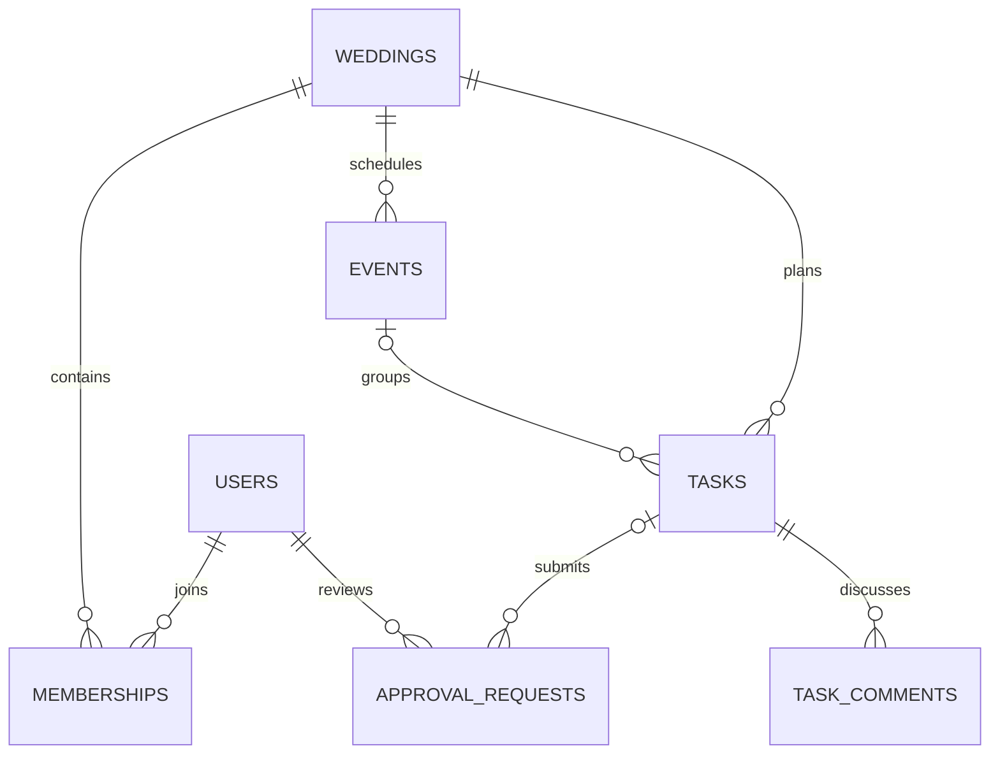
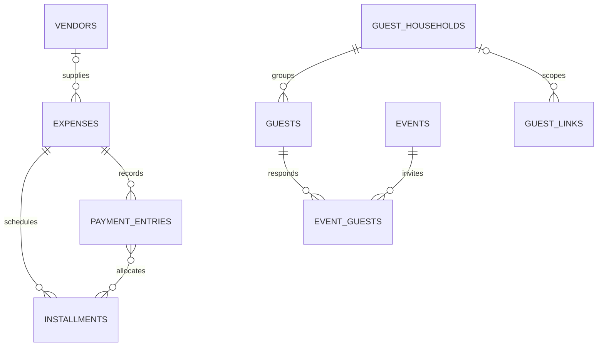
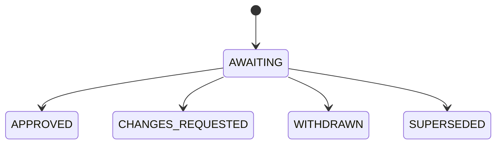

# PlanBridge Database Design

**Version:** 1.0  
**Date:** 21 October 2026  
**Status:** Implementation proposal based on the approved PRD and System Design v1  
**Database:** MongoDB Atlas  
**Application:** TypeScript, Next.js Route Handlers on Node.js, modular monolith

## 1. Purpose and decisions

This document defines the persisted data, relationships, access boundaries, indexes and consistency rules for PlanBridge. It is a database design specification, not deployed schemas or tested migration code. Collection names and technical defaults below are recommendations unless already established in the approved documents.

Use one application database per environment with shared collections. A wedding is the tenant. Do not create a collection or database per wedding. Store file bytes in private Cloudflare R2; MongoDB stores file metadata and permissions only. At the initial scale, use ordinary indexed collections without sharding, event sourcing or a separate analytics database.

### 1.1 Clarifications against earlier documents

| Topic | Database decision | Reason |
| --- | --- | --- |
| Task completion | Keep progress and approval separate. Approval permits completion; it does not complete the task automatically. | Restores PRD TASK-01/APR-02 behaviour. The system design’s automatic completion sentence should be corrected. |
| Approval authority | Any member may submit; only the currently assigned active admin decides. Admins may reassign with history. | Preserves PRD APR-01 rather than treating every admin as the assigned reviewer. |
| Cancelled expenses | Exclude cancelled proposals from active forecast, but retain cancellation liability, payments and refunds in settlement totals. | Prevents cancellation from hiding money still owed or paid. |
| Installments | Store installment schedules and explicit payment allocations. | A payment total alone cannot identify which installment is overdue. |
| Guest reminders | Member-initiated at launch; task/payment reminders are opt-in. | A scheduled processor is not permission to create automatic guest campaigns. |
| Media | Original files, immutable final keys and moderation; no derivatives or image-processing fields. | Latest architecture replaces earlier PRD image sanitisation/EXIF-removal wording. |
| Roles | ADMIN and MANAGER only; designated owner is a wedding field. | Ownership is a specific responsibility, not another general role. |

### 1.2 Implementation stages

| Stage | Collections to introduce |
| --- | --- |
| Planning pilot | users, sessions, authTokens, weddings, memberships, memberInvites, events, tasks, taskComments, approvalRequests, activity, notifications, notificationJobs, emailBatches, webhookEvents, emailSuppressions, idempotency, rateCounters; media/uploadGrants/weddingUsage for private task attachments |
| Commercial planning | vendors, expenses, installments, paymentEntries, guestHouseholds, guests, eventGuests, guestLinks, guestSessions, weddingSites, importRuns, importRows; extend existing media and notification modules |
| Paid launch | purchases and package entitlement rules; deletionJobs and recovery procedures before accepting paying customers |
| Optional URL rename | weddingSlugs; defer if slugs stay immutable at launch |
| Later | Public vendor discovery and planner portfolio membership models; no speculative collections now |

These collections are introduced with their features, not all implemented before the pilot. A collection is a data boundary, not a separate service.

## 2. Shared conventions

### 2.1 Types and common fields

The following notation is used in the field dictionaries:

- `Id`: BSON ObjectId, serialised as a hex string in REST responses.
- `Instant`: BSON Date in UTC; API accepts/returns ISO 8601 timestamps.
- `DateOnly`: validated `YYYY-MM-DD` string. Wedding dates are calendar dates, not midnight UTC timestamps.
- `Money`: BSON Long containing integer paise. REST uses an integer string, such as `"20000000"` for ₹200,000. Parse with BigInt/Long; never convert financial calculations through floating-point rupees. [D5]
- `Int`: bounded BSON Int32; `Bytes`: nonnegative BSON Long, serialised as an integer string.
- `?` means optional and omitted when absent. Do not mix missing fields, empty strings and null for the same meaning.
- `Enum(...)` means only the listed values are valid.

Every collection has `_id: Id`, `schemaVersion: Int = 1`, and `createdAt: Instant`. Mutable records also have `updatedAt: Instant` and `version: Int = 1` for optimistic concurrency. Immutable ledger/history entries omit mutable timestamps/version. All wedding-owned collections require `weddingId: Id`; global collections are explicitly identified below.

Store `createdByUserId` and `updatedByUserId` on member-managed records. For actions by guests or automated jobs, use an actor object:

```typescript
type Actor =
  | { kind: 'USER'; userId: ObjectId }
  | { kind: 'GUEST_LINK'; guestLinkId: ObjectId; displayName?: string }
  | { kind: 'SYSTEM'; jobId?: ObjectId };
```

Guest-supplied names are unverified attribution. Never turn a display name into an authenticated identity.

### 2.2 Validation and limits

Use application validation for inputs and MongoDB validators for stored types, required fields, enum values and basic bounds. MongoDB validation is not a substitute for foreign-key checks or permission checks. [D4]

Recommended engineering bounds: title/name 200 characters, short labels 100, notes/descriptions 10,000, URLs 2,048, and at most 20 media references per submission or comment. These are adjustable technical defaults, not agreed package limits. Reject oversized arrays; do not truncate silently. Dates, counts and financial amounts need range checks before persistence.

Store currency as `INR` for launch. Money is nonnegative except where a derived balance may be negative. Refund/reversal direction is represented by entry type, not arbitrary signed input. Bound financial totals below the BSON Long maximum and reject overflow; define a realistic business ceiling before production.

### 2.3 References, embedding and isolation

Embed bounded settings, addresses, venue details, immutable submission snapshots and bounded payment allocations. Reference independently edited or growing records: members, tasks, guests, photos, comments and payment history.

MongoDB does not enforce the relationships drawn below. Every referenced task, event, expense, guest, media record and membership must belong to the same wedding. Check this in services, including every array of referenced IDs. Repository operations require a server-resolved wedding ID:

```typescript
await tasks.findOne({ _id: taskId, weddingId: authorizedWeddingId });
```

This filter alone is not authorization: authenticate the caller, check current membership/link scope and wedding lifecycle first. No browser connects directly to Atlas. Administrative background jobs are the only deliberate cross-wedding queries and use dedicated internal entry points.

## 3. Relationship diagrams

### 3.1 Collaboration and approvals



A user may have historical memberships, but only one active membership at launch. An approval request has exactly one subject: task or expense. The diagram shows only its task relationship; reviewer assignments are checked against active admin membership.

### 3.2 Finances and attendance



Allocations are bounded embedded items in payment entries, not another many-to-many collection. Every entity in these diagrams is also scoped to its wedding.

## 4. Identity, weddings and memberships

### 4.1 `users` — global

| Field | Type / rule |
| --- | --- |
| email, normalizedEmail | String; retain entered email for display; unique normalizedEmail |
| displayName | String |
| passwordHash | String; encoded Argon2id hash with algorithm parameters |
| status | ACTIVE / DISABLED / DELETION_PENDING |
| emailVerifiedAt? | Instant |
| authVersion | Int; increment on password reset or global session revocation |
| notificationPreferences | Object: taskEmailEnabled, paymentEmailEnabled; false initially |
| passwordChangedAt? | Instant |

Define normalization once: trim and lowercase for the application’s email identity policy; do not remove dots or plus suffixes. Changing email requires verifying the new address before replacing normalizedEmail. No password, reset token, session token or raw capability appears in logs/activity.

### 4.2 `sessions` and `authTokens` — global

| Collection | Fields beyond common fields | Rules |
| --- | --- | --- |
| sessions | userId: Id; tokenHash: String; authVersion: Int; expiresAt: Instant; revokedAt?: Instant; lastSeenAt?: Instant | Compare user/session authVersion; check expiry and revocation on every use. Hash the random token, not the cookie header. |
| authTokens | userId: Id; tokenHash: String; purpose: VERIFY_EMAIL / RESET_PASSWORD / CHANGE_EMAIL; targetEmail?: String; expiresAt: Instant; consumedAt?: Instant; authVersion: Int | One-use conditional consume in the same transaction as the account change. CHANGE_EMAIL requires targetEmail. |

TTL is cleanup only; expired records may remain until the background deletion pass. Application expiry checks are mandatory. [D2]

### 4.3 `weddings`

| Field | Type / rule |
| --- | --- |
| brideName, groomName | String; display fields, never identifiers |
| weddingDate? | DateOnly; absent means not yet known |
| timeZone | String; valid IANA identifier; proposed initial default Asia/Kolkata |
| slug | String; unique readable names/date/random suffix; immutable by default |
| ownerUserId | Id; must have ACTIVE ADMIN membership |
| status | ACTIVE / ARCHIVED / DELETION_PENDING |
| membershipVersion | Int; serialisation guard for membership/admin changes |
| budgetPaise? | Money; whole-wedding planning budget |
| currency | INR |
| settings | Object: galleryPublished: Boolean, rsvpClosesAt?: Instant, uploadsCloseAt?: Instant |
| entitlement | Object: source PILOT / PURCHASE; purchaseId?: Id; packageCode: String; packageVersion: Int; status ACTIVE / EXPIRED / REVOKED; startsAt: Instant; endsAt?: Instant; limits: bounded object |

Limits may include maxActiveMembers, maxGuests, maxStoredBytes, maxPhotos and emailAllowance. Their actual values remain undecided. Pilot access needs explicit configured limits before external uploads; missing limits must not mean unlimited. Archive, package expiry and deletion have different effects and must not share one boolean.

Optional `weddingSlugs` when URL renaming is implemented: `_id`, `weddingId`, `slug`, `kind: CURRENT / REDIRECT / TOMBSTONE`, `createdAt`. All slug claims live in this single globally unique namespace; the wedding’s slug is a cache updated transactionally. Do not let an old redirect be reassigned to another wedding. Without this collection, do not implement renames.

### 4.4 `memberships`

| Field | Type / rule |
| --- | --- |
| userId | Id |
| role | ADMIN / MANAGER |
| status | ACTIVE / REMOVED / LEFT |
| joinedAt | Instant |
| endedAt? | Instant, required when inactive |
| invitedByUserId? | Id |

Unique weddingId + userId retains one membership row per pair; rejoining reactivates it and records history. A separate partial unique index on userId where status is ACTIVE enforces one wedding per account. Future multi-wedding support drops that index after permission/UI changes; no data migration into a different ownership model is required.

### 4.5 `memberInvites`

Fields: `recipientEmailNormalized: String`, `role: ADMIN|MANAGER`, `tokenHash: String`, `status: PENDING|ACCEPTED|REVOKED|EXPIRED`, `invitedByUserId: Id`, `expiresAt: Instant`, `acceptedByUserId?: Id`, `acceptedAt?: Instant`, `revokedAt?: Instant`.

Only admins create invites. Acceptance requires a matching verified email and an available active-membership slot. Keep one PENDING invite per wedding/email. Because a partial unique index cannot use the moving clock as its filter, the service marks an expired PENDING invite EXPIRED before replacing it. Do not rely on TTL to unblock a resend. Retain lifecycle records according to the audit policy.

## 5. Events, tasks and versioned approvals

### 5.1 `events`

Fields: `name: String`, `description?: String`, `startsAt?: Instant`, `endsAt?: Instant`, `venue?: {name, address, mapUrl}`, `status: ACTIVE|CANCELLED`, `publicSchedule: Boolean`, `internalNotes?: String`.

Dates may be missing during planning; if present, endsAt must be after startsAt. Event visibility has two independent layers: publicSchedule permits inclusion in published common information; individual eligibility comes from eventGuests. Internal notes never enter published payloads. Event cancellation removes it from current attendance/deadline calculations without deleting history.

### 5.2 `tasks`

| Field | Type / rule |
| --- | --- |
| eventId? | Id; optional event association |
| title, description? | String |
| assigneeUserId? | Id; active member at assignment time |
| priority | LOW / NORMAL / HIGH |
| dueAt? | Instant |
| progress | TODO / IN_PROGRESS / DONE / CANCELLED |
| approvalRequired | Boolean |
| contentRevision | Int; increment only for approval-relevant changes |
| currentApprovalRequestId? | Id |
| attachmentMediaIds | Bounded Id array; private files |
| completedAt?, cancelledAt? | Instant |

“Waiting for approval” is a derived UI label when the current request is AWAITING; it is not a second authoritative task state. A task can have approved content and still be IN_PROGRESS. Changing assignee/due date increments version but not contentRevision. Changing submitted content/files increments both, reopens DONE work and supersedes any pending request. Historical approved requests are retained unchanged; they no longer authorize the new contentRevision.

For approvalRequired tasks, DONE requires an APPROVED current request whose subjectRevision equals contentRevision. Removing approvalRequired after submission history is admin-only and needs a recorded reason. CANCELLED work stops reminders.

### 5.3 `taskComments`

Fields: `taskId: Id`, `actor: Actor`, `body: String`, `attachmentMediaIds: Id[]`, `editedAt?: Instant`, `deletedAt?: Instant`.

Recommended default: author may edit their own comment; admin may redact inappropriate content with activity history. Comment deletion does not remove immutable submission snapshots. Do not embed an ever-growing comments array in tasks.

### 5.4 `approvalRequests`

| Field | Type / rule |
| --- | --- |
| subjectType | TASK / EXPENSE |
| subjectId | Id; resolves within wedding and subjectType |
| subjectRevision | Int |
| submissionNumber | Int; monotonic per subject, including resubmissions of unchanged content |
| snapshot | Immutable bounded object: title, description, mediaIds; expense snapshots also include amountPaise, currency and scope |
| submittedByUserId, assignedAdminUserId | Id |
| submittedAt | Instant |
| status | AWAITING / APPROVED / CHANGES_REQUESTED / WITHDRAWN / SUPERSEDED |
| decision? | Object: decidedByUserId, decidedAt, reason? |
| supersededByRequestId? | Id |

There is at most one AWAITING request per subject. A snapshot cannot be edited in place. The assigned admin must still be active at decision time. Reassignment updates the request’s assignedAdminUserId/version and appends activity. Requesting changes requires a reason. Member removal must reassign outstanding approvals or leave them explicitly unassigned for admin resolution; proposed rule is to require reassignment before removal so no awaiting request loses its reviewer.



New submissions create new records. None of these terminal decisions is overwritten to represent a later submission.

## 6. Vendors, expenses, installments and payments

### 6.1 `vendors`

Fields: `name: String`, `category: String`, `contactName?: String`, `email?: String`, `phone?: String`, `notes?: String`, `bookingStatus: CONSIDERING|CONTACTED|BOOKED|CANCELLED`, `eventIds: Id[]`, `documentMediaIds: Id[]`, `archivedAt?: Instant`.

A vendor is a wedding-private contact, not a marketplace identity. Names/phones are not globally unique. Archiving preserves expense references. Bound event/document arrays in application validation.

### 6.2 `expenses`

| Field | Type / rule |
| --- | --- |
| vendorId?, eventId? | Id |
| title, category, description? | String |
| status | ACTIVE / CANCELLED |
| estimatePaise? | Money |
| approvalRequired | Boolean |
| contentRevision | Int; approval-controlled scope/amount revision |
| proposedCommitment? | Object: amountPaise: Money, scope: String, revision: Int |
| effectiveCommitment? | Object: amountPaise: Money, scope: String, revision: Int, acceptedAt: Instant, acceptedByUserId: Id, approvalRequestId?: Id |
| currentApprovalRequestId? | Id |
| cancellationSettlement? | Object: finalLiabilityPaise: Money, reason: String, recordedAt: Instant, recordedByUserId: Id |
| currency | INR |
| attachmentMediaIds | Bounded Id array |

Estimate, proposal and accepted liability are different values. An unapproved proposal must never silently overwrite effectiveCommitment. When editing an already agreed expense, keep the previous commitment effective until a replacement is accepted; show the pending proposed change separately. Approval-controlled changes require current-version admin approval. Accepting an uncontrolled commitment is an explicit audited member action.

For cancellation, require an explicit final liability; zero is a valid deliberate settlement, not a default inferred from cancelled status. If liability is unknown, record `settlementPending: true` as an additional Boolean field and retain the last effective liability as provisional, visibly labelled; outstanding is not final until settled. Cancelling a vendor contact alone does not cancel all its expense records.

### 6.3 `installments`

Fields: `expenseId: Id`, `label: String`, `amountPaise: Money`, `dueAt: Instant`, `status: ACTIVE|CANCELLED`, `sequence: Int`.

Paid status and overdue amount are derived, not manually editable fields. Warn if active installment totals differ from the effective commitment/final settlement; a schedule may be incomplete during planning. Do not reduce an installment below its existing net allocation without adjusting allocations through correction entries. Schedule changes are versioned and audited.

### 6.4 `paymentEntries`

| Field | Type / rule |
| --- | --- |
| expenseId | Id |
| kind | PAYMENT / REFUND / REVERSAL |
| amountPaise | Positive Money |
| paidAt | Instant; when the payment/refund occurred |
| payer | Object: displayName: String; userId?: Id; a payer need not be a member |
| method | CASH / BANK_TRANSFER / UPI / CARD / OTHER |
| reference? | String; not unique because manual references can repeat |
| receiptMediaId? | Id; private receipt, not gallery content |
| allocations | Bounded array of {installmentId: Id, amountPaise: Money} |
| originalPaymentId? | Id; required for REFUND |
| reversesEntryId? | Id; required for REVERSAL |
| reason? | String; required for reversal/correction |
| recordedByUserId | Id |
| operationKey | String; unique within wedding; durable retry protection |

Entries are append-only. Correct a mistaken payment with one exact reversal plus a replacement payment in a transaction. A reversal stores the same amount and allocations as the original and contributes its opposite effect. Do not permit reversal of a reversal; reverse a refund only when its remaining constraints are valid. Refunds are real returned money and must not be used to hide data-entry mistakes.

Define ledger effect: PAYMENT = +amount, REFUND = −amount, REVERSAL = negative of the referenced entry’s effect. Exactly one reversal is allowed per entry. Refunds cannot exceed the referenced payment’s remaining unrefunded amount. An allocated refund cannot exceed that payment’s remaining allocation to that installment. Reversing a payment with active refunds is rejected until those refunds are resolved. Serialize all payment, refund, reversal and allocation edits through an update to the expense version inside a transaction.

The sum of allocation amounts must be at most the entry amount, every installment must belong to the same expense/wedding, and duplicate installment IDs in one entry are rejected. Unallocated money counts in net paid but not as settling an installment. The UI must flag that distinction.

### 6.5 Financial calculations

| Metric | Calculation |
| --- | --- |
| Active committed | Sum effective commitments on ACTIVE expenses |
| Cancellation liability | Sum explicit final cancellation liabilities; show provisional unsettled liabilities separately |
| Total liability | Active committed + cancellation liabilities, with provisional amounts clearly identified |
| Forecast | For each ACTIVE expense use effective commitment if present, otherwise estimate; add cancellation liability separately for full budget exposure |
| Net paid | Sum signed ledger effects, including cancelled expenses |
| Outstanding / credit | Liability − net paid; retain negative values as credits |
| Installment unpaid | Installment amount − signed allocations to that installment |
| Overdue | Positive unpaid amount on ACTIVE installments with dueAt before now; no overdue flag based only on total outstanding |
| Forecast remaining | Wedding budget − full forecast exposure |

For ₹200,000 accepted and ₹50,000 paid, outstanding is ₹150,000. If cancellation settles liability at ₹20,000, the balance is −₹30,000 until that refund is recorded. A cancelled flag must never erase the ₹50,000 payment.

Compute totals from source records at launch. Avoid independently writable paidTotal/outstanding fields. If later materialised for performance, mark them as rebuildable projections with reconciliation jobs.

## 7. Guests, eligibility and capability access

### 7.1 `guestHouseholds` and `guests`

| Collection | Fields beyond common fields |
| --- | --- |
| guestHouseholds | label: String; primaryContact: {name?: String, email?: String, phone?: String}; side?: String; group?: String; remindersOptOut: Boolean; archivedAt?: Instant |
| guests | householdId: Id; displayName: String; isPlaceholder: Boolean; ageGroup: ADULT / CHILD / UNKNOWN; dietaryNotes?: String; archivedAt?: Instant; importSource?: {runId: Id, rowKey: String} |

Named members and allocated placeholders each count as one person. Do not store a household headcount that can disagree with individual guest rows. A guest may have no email. Duplicate names are valid; never merge records on name alone. Moving a guest between households revokes/rechecks affected link access and produces history.

### 7.2 `eventGuests`

Fields: `eventId: Id`, `guestId: Id`, `invitationStatus: INVITED|REMOVED`, `rsvp: NO_RESPONSE|ACCEPTED|DECLINED`, `respondedAt?: Instant`, `respondedBy?: Actor`, `removedAt?: Instant`.

Unique weddingId + eventId + guestId prevents duplicate invitations. Only INVITED rows for active events and active guests count in attendance. Guest access resolves the guest’s current household, not a household ID supplied by the request. Removal retains the row/history. Recommended reinvitation rule: reset RSVP to NO_RESPONSE and record the previous value in activity so old acceptance is not silently reused. Event time edits do not automatically reset RSVP.

### 7.3 `guestLinks` and `guestSessions`

| Collection | Fields and rules |
| --- | --- |
| guestLinks | weddingId; kind: HOUSEHOLD_RSVP / PHOTO_UPLOAD / GALLERY; householdId?: Id required only for RSVP; tokenHash: String; tokenCiphertext?: encrypted envelope; status: ACTIVE / REVOKED; expiresAt?: Instant; accessVersion: Int; createdByUserId: Id; revokedAt?: Instant |
| guestSessions | weddingId; guestLinkId: Id; tokenHash: String; linkAccessVersion: Int; expiresAt: Instant; revokedAt?: Instant |

Each link has one purpose, avoiding ambiguous combined permissions. RSVP eligibility is derived from current eventGuests; do not embed stale guest/event arrays in the capability. Gallery and upload links do not confer household RSVP or member access. The QR encodes the upload URL, not a separate secret in MongoDB.

Guest sessions are scoped bearer sessions, not guest accounts. On every use check their expiry, parent link status/version, wedding status and the relevant feature’s publishing/closing state. Revoking a link blocks all child sessions without waiting for their TTL cleanup. Media capabilities bind to the originating session/link and current media accessVersion; the gateway checks current database state before returning cached bytes.

**Token delivery detail:** hashing alone cannot support later copying or emailing the same link. Proposed design: keep the verification hash plus an application-encrypted token envelope only where repeat sharing is required. Encryption keys stay outside MongoDB. Decrypt only after authorized copy/send actions; never expose tokens through general list responses. Short-lived account tokens are kept encrypted only in their pending email payload, then purged. This is a deliberate exception to hash-only storage for verification, not plaintext token storage.

### 7.4 `importRuns` and `importRows`

`importRuns`: `kind: GUEST_CSV`, `operationKey: String`, `sourceMediaId?: Id`, `sourceHash: String`, `mappingVersion: Int`, `status: PREVIEW|COMMITTING|COMPLETE|FAILED|CANCELLED`, `createdByUserId`, `rowCount`, `validCount`, `committedCount`, `cleanupAt?: Instant`.

`importRows`: `runId: Id`, `rowNumber: Int`, `rowKey: String`, `normalizedData: bounded object`, `errors: bounded String[]`, `warnings: bounded String[]`, `status: VALID|INVALID|SKIPPED|COMMITTED`, `createdGuestId?: Id`, `cleanupAt?: Instant`.

Unique run/row number and operation keys make resumable chunk commits safe. Store duplicate warnings in preview; do not auto-merge names. Repeating an existing operation returns its result. Re-uploading the same source with a new operation should warn rather than silently import everything again. Clean preview data only after completion/cancellation and retention expiry; never TTL unfinished work. Escape spreadsheet formula prefixes on export.

## 8. Website, media and quotas

### 8.1 `weddingSites`

One document per wedding. Fields: `draft: SiteContent`, `draftRevision: Int`, `published?: SiteContent`, `publishedRevision?: Int`, `publishedAt?: Instant`, `publishedByUserId?: Id`, `isPublished: Boolean`.

`SiteContent` is a bounded allowlist: themeId (one of three known codes), welcomeText, couple display names, weddingDate?, coverMediaId?, invitationMediaId?, schedule snapshots and venue links. No arbitrary HTML/JavaScript. A published snapshot never contains internal notes, budgets, contact lists or pending gallery files.

Publishing copies validated draft content atomically to published. Draft edits remain private. For household schedules, intersect published event snapshots with current invitation eligibility; cancelled events are excluded immediately. Date/venue changes require explicit republishing to alter the snapshot and an explicit user action to send updates. Unpublishing prevents reads regardless of cached site content. Content image publication is separate from GALLERY_PHOTO approval; use explicit media purpose and publication authorization.

### 8.2 `media`

| Field | Type / rule |
| --- | --- |
| purpose | GALLERY_PHOTO / TASK_ATTACHMENT / RECEIPT / VENDOR_DOCUMENT / SITE_ASSET / INVITATION / IMPORT_SOURCE |
| state | STAGING / READY / DELETE_PENDING / DELETED / FAILED |
| moderation | NOT_APPLICABLE / PENDING / APPROVED / REJECTED |
| objectKey? | String; immutable final R2 key, set when READY |
| stagingKey | String; unique upload staging destination |
| originalFilename | String; display only, never an object path |
| contentType?, sizeBytes?, sourceETag? | Verified metadata |
| uploadedBy | Actor |
| eventId? | Id; photo association, not a privacy grant |
| parent? | Object: type TASK / EXPENSE / VENDOR / SITE / IMPORT; id: Id |
| accessVersion | Int; increment on moderation/access changes |
| reviewedByUserId?, reviewedAt?, rejectionReason? | Moderation metadata |
| deleteAfter?, deletedAt? | Instant |

Separating storage state from moderation avoids treating all receipts as public “approved” images. GALLERY_PHOTO is never readable by gallery guests unless READY + APPROVED + gallery published. All organizer-uploaded gallery photos also start PENDING. Other purposes use parent permissions; NOT_APPLICABLE never means public.

Metadata changes cannot redirect an existing approved media record to different bytes. A replacement upload gets a new media ID and key. Pending/rejected photo bytes are not returned to general guests. Managers may see moderation state without a publication right. Private task documents may support PDF; gallery validation supports only the configured raster types.

### 8.3 `uploadGrants` and `weddingUsage`

`uploadGrants`: `mediaId: Id`, `issuedTo: Actor`, `reservedBytes: Bytes`, `reservedFileCount: Int`, `status: ISSUED|FINALIZING|FINALIZED|EXPIRED|FAILED`, `expiresAt: Instant`, `leaseUntil?: Instant`, `leaseOwner?: String`, `leaseVersion: Int`, `cleanupCompletedAt?: Instant`, `purgeAt?: Instant`.

`weddingUsage`: one row per wedding; `storedBytes: Bytes`, `reservedBytes: Bytes`, `storedFiles: Int`, `reservedFiles: Int`, `photoCount: Int`, `reservedPhotos: Int`, `reconciledAt?: Instant`.

Reserve quota and insert the grant/media stub in one transaction. The conditional usage update enforces stored + reserved + new reservation ≤ configured allowance. Declared size is not trusted: verify actual size before finalization and atomically adjust or reject if it exceeds the reservation. Simultaneous uploads cannot each consume the same remaining capacity.

R2 copy/delete calls cannot be inside a MongoDB atomic transaction. Use a recoverable sequence: reserve → upload → validate → conditional immutable copy → commit READY/usage → clean staging. A failed final DB commit leaves a known orphan for reconciliation. Preserve grant/object identifiers until cleanup is confirmed. Only then set purgeAt for TTL; deleting an expired grant before reclaiming quota would leak capacity or files.

Deleting a media record first denies reads, then removes R2 bytes, then decrements usage exactly once and records DELETED. Reconcile aggregate usage against READY/DELETE_PENDING metadata and R2 inventory as appropriate. No image transformation jobs, thumbnail keys or EXIF-removal claims are included.

## 9. Notifications, email batches and durable jobs

### 9.1 `notifications` — in-app

Fields: `recipientUserId: Id`, `type: TASK_ASSIGNED|APPROVAL_REQUESTED|APPROVAL_DECIDED|DELIVERY_FAILED`, `resource: {type, id}`, `summary: String`, `dedupeKey: String`, `readAt?: Instant`.

Create after the relevant business write in the same transaction or through the durable outbox. On read, validate current wedding membership; an old notification is not authority to view a removed wedding. Use minimal summaries and resolve sensitive details through protected resource APIs.

### 9.2 `notificationJobs` — durable outbox

| Field | Type / rule |
| --- | --- |
| weddingId? | Id; absent only for global account/security email |
| kind | ACCOUNT / MEMBER_INVITE / GUEST_INVITE / GUEST_REMINDER / TASK_REMINDER / PAYMENT_REMINDER |
| recipient | Object: emailNormalized; userId?; householdId? |
| resource? | Object: type, id, revision? |
| templateCode, templateVersion | String, Int |
| payload | Bounded object with minimal rendering data; sensitive token-bearing material encrypted |
| dueAt, availableAt | Instant; intended send time and next retry time |
| state | QUEUED / LEASED / BATCHED / ACCEPTED / CANCELLED / FAILED / UNKNOWN |
| deliveryStatus | UNKNOWN / DELIVERED / BOUNCED / COMPLAINED |
| dedupeKey | Globally unique String derived from business operation and recipient |
| attempts, leaseVersion | Int |
| leaseOwner?, leaseUntil? | String, Instant |
| emailBatchId?, batchPosition? | Id, Int |
| providerMessageId? | String |
| lastErrorCode?, acceptedAt?, terminalAt?, purgeAt? | Diagnostic/timing fields |

Job acceptance and delivery are separate axes. DELIVERED is provider evidence, never “read.” Recheck eligibility, link validity, recipient membership/preferences and current task/payment/RSVP state immediately before creating a batch. Already accepted email cannot be recalled; revoke any included link if its access must end.

### 9.3 `emailBatches`

Fields: `provider: RESEND`, `jobIds: bounded Id[]`, `payloadCiphertext: encrypted envelope`, `payloadHash: String`, `providerIdempotencyKey: String`, `state: PREPARED|SENDING|ACCEPTED|RETRYABLE|UNKNOWN|FAILED`, `availableAt: Instant`, `firstAttemptAt?: Instant`, `safeRetryUntil?: Instant`, `attempts: Int`, `leaseOwner?: String`, `leaseUntil?: Instant`, `leaseVersion: Int`, `results: bounded array of {jobId, providerMessageId?, errorCode?}`, `purgeAt?: Instant`.

Use one small configurable batch, such as 25 messages, as a starting recommendation. Freeze exact rendered payload and ordering before the first provider call. Link each job to one batch transactionally so it cannot be assigned to another batch while an outcome is uncertain. Encrypt the frozen payload because invitation links are credentials.

Recovery retries the same batch/key/payload, not a newly rendered message. Store safeRetryUntil from the provider’s verified idempotency horizon; do not assume provider deduplication lasts forever. Unknown outcomes beyond that horizon require reconciliation/review. Terminal payloads containing tokens should be purged or redacted as soon as the chosen operational retention permits.

### 9.4 `webhookEvents` and `emailSuppressions` — global

`webhookEvents`: `provider: RESEND|<selected billing provider>`, `providerEventId: String`, `eventType: String`, `providerObjectId?: String`, `occurredAt?: Instant`, `receivedAt: Instant`, `payload: minimized object`, `state: RECEIVED|PROCESSED|FAILED`, `attempts: Int`, `availableAt: Instant`, `leaseOwner?: String`, `leaseUntil?: Instant`, `leaseVersion: Int`, `processedAt?: Instant`, `purgeAt?: Instant`. Insert only after verifying the signature. Deduplicate provider/event ID; derive wedding ownership through existing job/purchase mappings, not webhook-supplied tenant claims.

`emailSuppressions`: `emailNormalized: String`, `scope: GLOBAL|WEDDING_REMINDERS`, `scopeKey: String` (GLOBAL or wedding ID string), `reason: HARD_BOUNCE|COMPLAINT|OPT_OUT`, `sourceEventId?: Id`, `active: Boolean`, `clearedAt?: Instant`.

A reminder opt-out does not disable security email. A hard bounce still makes that address undeliverable. Apply privacy-conscious suppression lookup without exposing global suppression history to wedding users. Protect webhook processing against out-of-order events; a later-arriving older event must not clear a complaint or hard bounce.

## 10. Audit, idempotency, billing and lifecycle

### 10.1 `activity`

Fields: `actor: Actor`, `action: String enum defined in code`, `resourceType: String`, `resourceId: Id`, `requestId?: String`, `before?: bounded object`, `after?: bounded object`, `reason?: String`, `occurredAt: Instant`.

Append-only through application services. Store the meaningful changed fields, not whole documents, passwords, cookies, file URLs or token-bearing payloads. Preserve user IDs and a minimal display-name snapshot if needed after member removal. Business actors have no edit/delete-history endpoint. This is application audit history, not a claim of cryptographically tamper-proof storage.

### 10.2 `idempotency` — global operational collection

Fields: `scopeKey: String` (actor + wedding + operation), `key: String`, `requestHash: String`, `state: IN_PROGRESS|COMPLETE|FAILED`, `leaseUntil?: Instant`, `leaseVersion: Int`, `resourceId?: Id`, `responseStatus?: Int`, `responseBody?: bounded redacted object`, `expiresAt?: Instant`.

Same scope/key with different input returns conflict. For a completed key, return the prior result. Transient IN_PROGRESS claims need recovery. Financial operations also retain a permanent operationKey on paymentEntries, so expiry of this cache cannot permit an old payment retry to double-count. Avoid persisting secret-bearing response bodies.

### 10.3 `rateCounters` — global operational collection

Fields: `keyHash: String`, `policy: String`, `windowStart: Instant`, `count: Int`, `expiresAt: Instant`. Unique keyHash + policy + windowStart. Increment atomically; reject over-limit requests. Use server-controlled windows and hashed account/IP/wedding keys with a secret where appropriate. TTL removes old counters; it does not enforce the request limit.

### 10.4 `purchases` — paid launch

Fields: `weddingId`, `ownerUserId`, `packageCode`, `packageVersion`, `pricePaise: Money`, `currency: INR`, `entitlementSnapshot: bounded object`, `status: CREATED|PENDING|PAID|FAILED|REFUNDED`, `provider?: String`, `providerOrderId?: String`, `providerPaymentId?: String`, `operationKey: String`, `paidAt?: Instant`, `refundedAt?: Instant`.

Keep package definitions in versioned application configuration initially, not an admin CMS. Store the purchased price/limits/duration snapshot so later price changes do not rewrite a prior sale. A verified payment event atomically marks purchase PAID and updates wedding entitlement. Browser success redirects cannot activate access. Provider-specific refunds, invoices and partial-refund states require a separate design once the provider and commercial rules are chosen; do not pretend this provisional schema resolves them.

### 10.5 `deletionJobs`

Fields: `weddingId`, `requestedByUserId`, `state: PENDING|RUNNING|WAITING|COMPLETE|FAILED`, `notBefore: Instant`, `phase: String`, `cursor?: String`, `attempts: Int`, `availableAt: Instant`, `leaseOwner?: String`, `leaseUntil?: Instant`, `leaseVersion: Int`, `lastErrorCode?: String`, `completedAt?: Instant`.

A wedding deletion first marks DELETION_PENDING and blocks access/sends/uploads. Then process bounded, retryable deletion phases across R2, operational data and business collections. Preserve legally required purchase records only under an explicitly chosen retention policy, with personal data minimized. Do not delete the wedding root or cleanup evidence before child/R2 removal completes. Users are global identities and are not automatically deleted when one wedding is deleted.

## 11. Index catalogue

All collections already have the `_id` index. Keys below are in order; directions default to ascending unless shown. `U` means unique; `P` means partial; `TTL(field)` means a single-field index with expireAfterSeconds: 0. Create only indexes used by the current release and verify query plans on representative data. Partial index queries must include a compatible predicate. [D1]

| Collection | Required indexes / purpose |
| --- | --- |
| users | U(normalizedEmail) |
| sessions | U(tokenHash); (userId, expiresAt); TTL(expiresAt) |
| authTokens | U(tokenHash); (userId, purpose); TTL(expiresAt) |
| weddings | U(slug); (ownerUserId, status) |
| weddingSlugs, if used | U(slug); (weddingId, kind) |
| memberships | U(weddingId, userId); U(userId) P(status=ACTIVE); (weddingId, status, role) |
| memberInvites | U(tokenHash); U(weddingId, recipientEmailNormalized) P(status=PENDING); (weddingId, status, expiresAt) |
| events | (weddingId, status, startsAt, _id) |
| tasks | (weddingId, progress, dueAt, _id); (weddingId, assigneeUserId, progress, dueAt, _id) |
| taskComments | (weddingId, taskId, createdAt, _id) |
| approvalRequests | U(weddingId, subjectType, subjectId, submissionNumber); U(weddingId, subjectType, subjectId) P(status=AWAITING); (weddingId, assignedAdminUserId, status, submittedAt, _id) |
| vendors | (weddingId, name, _id) |
| expenses | (weddingId, status, createdAt, _id); (weddingId, vendorId) |
| installments | (weddingId, status, dueAt, _id); (weddingId, expenseId) |
| paymentEntries | U(weddingId, operationKey); U(weddingId, reversesEntryId) P(reversesEntryId type objectId); (weddingId, expenseId, paidAt, _id); (weddingId, originalPaymentId) |
| guestHouseholds | (weddingId, label, _id) |
| guests | (weddingId, householdId, _id); U(weddingId, importSource.runId, importSource.rowKey) P(importSource.runId type objectId) |
| eventGuests | U(weddingId, eventId, guestId); (weddingId, guestId, invitationStatus); (weddingId, eventId, invitationStatus, rsvp, _id) |
| guestLinks | U(tokenHash); (weddingId, kind, status); (weddingId, householdId, kind) |
| guestSessions | U(tokenHash); (weddingId, guestLinkId); TTL(expiresAt) |
| importRuns | U(weddingId, operationKey); (weddingId, sourceHash); TTL(cleanupAt) |
| importRows | U(weddingId, runId, rowNumber); (weddingId, runId, status, rowNumber); TTL(cleanupAt) |
| weddingSites | U(weddingId) |
| media | U(stagingKey); U(objectKey) P(objectKey type string); (weddingId, purpose, state, moderation, createdAt descending, _id descending); (weddingId, parent.type, parent.id) |
| uploadGrants | U(weddingId, mediaId); (status, expiresAt); (status, leaseUntil); TTL(purgeAt) |
| weddingUsage | U(weddingId) |
| notifications | U(weddingId, recipientUserId, dedupeKey); (weddingId, recipientUserId, createdAt descending, _id descending) |
| notificationJobs | U(dedupeKey); (state, availableAt, _id); (state, leaseUntil); U(providerMessageId) P(providerMessageId type string); (weddingId, createdAt descending); TTL(purgeAt) |
| emailBatches | U(providerIdempotencyKey); (state, availableAt, _id); (state, leaseUntil); TTL(purgeAt) |
| webhookEvents | U(provider, providerEventId); (state, availableAt, _id); (state, leaseUntil); TTL(purgeAt) |
| emailSuppressions | U(emailNormalized, scope, scopeKey) |
| activity | (weddingId, occurredAt descending, _id descending); (weddingId, resourceType, resourceId, occurredAt descending) |
| idempotency | U(scopeKey, key); TTL(expiresAt) |
| rateCounters | U(keyHash, policy, windowStart); TTL(expiresAt) |
| purchases | U(weddingId, operationKey); U(provider, providerOrderId) P(providerOrderId type string); U(provider, providerPaymentId) P(providerPaymentId type string); (weddingId, createdAt descending) |
| deletionJobs | (state, availableAt, _id); (state, leaseUntil); U(weddingId) |

No TTL on core wedding, payment, approval, guest-link or media records. Optional TTL dates are omitted until a record is eligible for cleanup. A single-field TTL index is separate from compound query indexes. [D2]

### 11.1 Illustrative mongosh definitions

These snippets demonstrate critical constraints; they are not a complete migration script.

```javascript
db.memberships.createIndex(
  { weddingId: 1, userId: 1 },
  { unique: true, name: 'uq_membership_wedding_user' }
);
db.memberships.createIndex(
  { userId: 1 },
  {
    unique: true,
    partialFilterExpression: { status: 'ACTIVE' },
    name: 'uq_one_active_wedding_per_user'
  }
);
db.approvalRequests.createIndex(
  { weddingId: 1, subjectType: 1, subjectId: 1 },
  {
    unique: true,
    partialFilterExpression: { status: 'AWAITING' },
    name: 'uq_one_awaiting_approval'
  }
);
db.paymentEntries.createIndex(
  { weddingId: 1, reversesEntryId: 1 },
  {
    unique: true,
    partialFilterExpression: { reversesEntryId: { $type: 'objectId' } },
    name: 'uq_one_reversal_per_entry'
  }
);
db.sessions.createIndex(
  { expiresAt: 1 },
  { expireAfterSeconds: 0, name: 'ttl_sessions' }
);
```

Use type-based partial filters for optional unique values; a plain unique index on an optional field would treat missing values in ways that can reject legitimate rows. Validate the referenced field’s requiredness when the corresponding enum requires it.

## 12. Transactions, races and state transitions

MongoDB supports atomic document updates and multi-document transactions; use the latter for business changes that must commit together. Recommended driver transactions use snapshot reads, majority writes and primary read preference. Keep external R2/Resend/payment calls outside transactions. Transaction callbacks may retry, so use stable operation IDs and no external side effects inside them. [D3]

| Operation | Atomic unit and conflict guard |
| --- | --- |
| Create wedding | Wedding + owner ADMIN membership + usage row + activity; active-membership uniqueness prevents concurrent duplicate ownership creation. |
| Accept invite | Consume still-valid PENDING invite + activate membership + activity; update wedding membershipVersion to serialize membership changes. |
| Remove/reassign admin | Update membershipVersion, re-read active admins/owner, resolve assigned approvals, then change membership and append activity. Never remove last admin or leave owner without ADMIN access. |
| Submit/revise approval | Compare task/expense version and contentRevision; supersede current pending request; insert immutable new request; update subject pointer; append activity/notifications. |
| Decide approval | Check AWAITING, assigned active admin, exact subject revision and request version; update decision and subject eligibility/effective commitment. Do not auto-complete task. |
| Complete task | Conditional current task version + approved matching revision when required; audit change. |
| Record payment/refund | Lock through expense version update; check ledger constraints; insert append-only entry + durable operationKey + activity/outbox. |
| Household RSVP | Resolve current household/link, validate guest/event eligibility; update only changed rows with versions + activity. Serialize eligibility changes through the same eventGuest rows. |
| Publish website | Compare draftRevision/version; validate scoped media; copy published snapshot and append activity. |
| Reserve/finalize upload | Conditional usage update + grant/media transition; R2 operation occurs between transactions and is recoverable. |
| Moderate photo | Compare media version/state; admin-only decision + accessVersion increment + activity; no guest access before commit. |
| Prepare email batch | Claim jobs and create frozen batch + set job batch IDs in a transaction; provider call follows commit. |
| Activate purchase | Deduplicate webhook; verify provider mapping/amount/currency; update purchase + entitlement + activity. |

For privileged mutations where concurrent removal matters, perform a conditional update to the actor’s active membership within the same transaction as the action (for example increment an `authorizationFence: Int` field). Removal updates that same row, causing conflicting transactions to retry and recheck authority. General reads check current membership; a request already completed before removal is not undone.

### 12.1 Optimistic edits

```javascript
const result = await db.collection('tasks').updateOne(
  { _id: taskId, weddingId, version: expectedVersion },
  {
    $set: { dueAt: newDueAt, updatedAt: now, updatedByUserId: actorId },
    $inc: { version: 1 }
  },
  { session }
);
if (result.matchedCount !== 1) throw new ConflictError('TASK_CHANGED');
```

The application performs authorization and input validation before this operation; the snippet shows only concurrency control. Never let the browser supply arbitrary update operators.

### 12.2 Lease protocol for jobs

1. Atomically claim a due QUEUED job, set LEASED, owner/expiry and increment leaseVersion.
2. Perform bounded work. Completion updates must match `_id`, owner, state and leaseVersion.
3. A separate recovery query reclaims expired leases; use its own `(state, leaseUntil)` index.
4. BATCHED email jobs are recovered through their existing batch, never re-queued as fresh sends while delivery is uncertain.
5. Retry transient failures with backoff; expose permanent/unknown failures for review. Fencing prevents stale workers changing DB state, but cannot cancel an already-started external email request; provider idempotency is still required.

## 13. Query patterns and example records

### 13.1 Primary screens

| Screen | Query approach |
| --- | --- |
| Wedding dashboard | Separate bounded counts for active tasks, awaiting approvals, upcoming events and overdue installments; no single giant join pipeline. |
| My tasks | weddingId + assigneeUserId + selected progress; sort dueAt, _id; handle missing deadlines in a separate unscheduled view. |
| Approval inbox | weddingId + assignedAdminUserId + AWAITING; sort submittedAt, _id. |
| Finance overview | Scope expenses first; aggregate ledger by expense, then attach sums. Never unwind both payments and installments together and accidentally multiply totals. |
| Household RSVP | Find household’s active guests; fetch matching INVITED eventGuests and relevant published event snapshots; validate scope again on write. |
| Event attendance | weddingId + eventId + invitationStatus; group by RSVP and current guest ageGroup. |
| Approved gallery | weddingId + purpose GALLERY_PHOTO + state READY + moderation APPROVED; descending createdAt, _id cursor. |
| Activity | weddingId with occurredAt, _id cursor; optional resource filter. |
| Email operations | weddingId + recent createdAt for members; global state/availableAt worker query internally only. |

Use stable compound cursors with the tie-breaker `_id`, not large skip offsets. Project only fields needed by each endpoint. Large lists and exports are bounded/chunked. Add extra indexes only after observing the actual query shape with explain; the initial wedding count does not justify indexing every field.

### 13.2 Representative Extended JSON

Illustrative task requiring approval, still in progress:

```json
{
  "_id": { "$oid": "680000000000000000000001" },
  "weddingId": { "$oid": "680000000000000000000010" },
  "schemaVersion": 1,
  "version": 4,
  "createdAt": { "$date": "2026-10-21T09:00:00Z" },
  "updatedAt": { "$date": "2026-10-21T10:00:00Z" },
  "title": "Finalize invitation and arrange printing",
  "progress": "IN_PROGRESS",
  "priority": "NORMAL",
  "approvalRequired": true,
  "contentRevision": 2,
  "currentApprovalRequestId": { "$oid": "680000000000000000000020" },
  "attachmentMediaIds": [],
  "createdByUserId": { "$oid": "680000000000000000000030" },
  "updatedByUserId": { "$oid": "680000000000000000000030" }
}
```

An installment amount of ₹50,000 is represented as `{"$numberLong":"5000000"}` in Extended JSON and `"5000000"` in the ordinary REST DTO. IDs in these examples are placeholders; do not seed them into production. Complete valid fixtures must create all referenced records.

## 14. Retention, deletion and restore

| Data | Retention approach |
| --- | --- |
| Sessions/auth tokens | TTL after absolute expiry; runtime checks continue regardless of cleanup timing. |
| Invitations/guest links | Explicit revoke/expire; retain enough history for delivery and access review, then policy-driven cleanup. |
| Upload grants/import previews | Set cleanup TTL only after quota, files and partial-import results are reconciled. |
| Email payloads | Minimize and encrypt; redact/purge secrets after terminal processing and operational retention. |
| Payments/approvals/activity | No automatic TTL; policy-driven retention and scoped deletion/export. |
| Photos and attachments | MongoDB metadata and R2 deletion are a coordinated workflow; database deletion alone does not remove bytes. |
| Purchases | Retention and anonymisation depend on selected provider and commercial obligations; unresolved before paid launch. |

A backup restore can resurrect previously revoked sessions, links or pending jobs. Restore into isolation first: pause all sending/deletion/upload jobs, rotate or invalidate all sessions/capabilities as needed, reconcile provider outcomes and deletion requests since the restore point, and compare R2 objects with metadata before reopening traffic. Do not let old outbox records send invitations automatically after restoration.

Atlas backup recovery does not restore R2 bytes. Maintain a separately chosen original-file recovery policy. Recovery-point/recovery-time targets and retention durations are still product/operational decisions, not guarantees made by this document.

## 15. Migration and verification plan

### 15.1 Migration approach

1. Version schemas and migrations in source control. Keep collection/index creation out of ordinary request handlers.
2. Pin and test against the selected Atlas server and Node driver versions; this document does not choose a server release.
3. Introduce additive fields and tolerant readers, backfill in bounded batches, validate, then tighten requirements.
4. Before adding unique indexes, detect duplicates and resolve them deliberately. Do not silently delete conflicting guest/payment rows.
5. Check index names/options, run migration on staging, then production with backup and rollback plan.
6. Prefer forward fixes; removing a field is a later migration after all old deployments stop writing it.

### 15.2 Required behavioural tests

- Cross-wedding IDs fail for reads, writes, nested references, attachments and exports.
- Concurrent wedding creation/joining cannot give one user two active memberships.
- Concurrent admin removals leave an active admin and valid owner; removed reviewers cannot approve after revocation takes effect.
- Assignment/deadline edits retain content approval; changed design/amount invalidates it. Approval alone does not mark task DONE.
- Concurrent payment retries yield one entry; partial payment, refund, reversal and cancellation balances reconcile exactly.
- Two overlapping refund requests cannot exceed the original payment; installment allocation totals remain valid.
- Household links cannot modify another household or a removed invitation; reinvitation follows its documented reset rule.
- Concurrent upload reservations cannot exceed quota; retry/failure does not release or consume the same reservation twice.
- Private receipts/pending photos cannot enter published gallery results; cached image access fails after revocation.
- Lost email acknowledgements preserve batch identity; stale workers cannot overwrite a newer lease; expired deduplication horizons enter review.
- TTL delay never extends access; unfinished cleanup jobs retain their reconciliation records.
- Restoring a database does not automatically restart stale sends or restore revoked access.

### 15.3 Decisions still open

Before implementation of each affected feature, select numeric package/file/email limits, supported upload types, token/session lifetimes, reminder timing, data retention, billing provider and restore objectives. Keep these values in validated configuration and package snapshots. No fixed numeric commercial quota is invented here.

## 16. Sources and relationship to earlier documents

Product baseline: **PlanBridge PRD v1.0** and **PlanBridge System Design v1.0**. The clarifications in section 1.1 are explicit proposed corrections to inconsistencies between them; this document does not silently edit either earlier file.

Official MongoDB documentation checked on 21 October 2026:

- [D1 — Partial indexes](https://www.mongodb.com/docs/manual/core/index-partial/)
- [D2 — TTL indexes](https://www.mongodb.com/docs/manual/core/index-ttl/)
- [D3 — Transactions](https://www.mongodb.com/docs/manual/core/transactions/)
- [D4 — Schema validation](https://www.mongodb.com/docs/manual/core/schema-validation/)
- [D5 — BSON types](https://www.mongodb.com/docs/manual/reference/bson-types/)

The collection schemas, business rules, staged implementation and tradeoffs are PlanBridge design proposals. Platform documentation supports database behaviour; it does not validate the product’s business assumptions.
