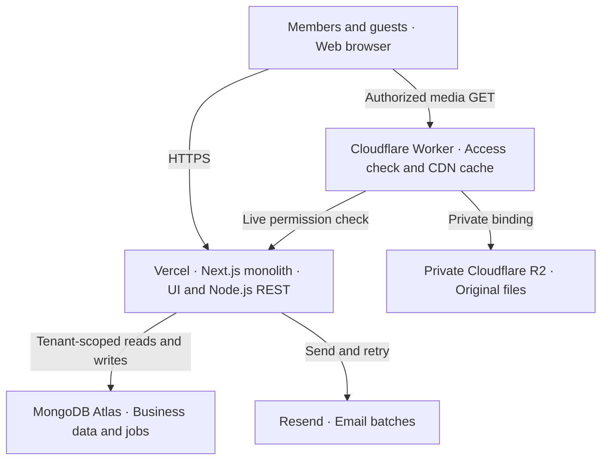

# PlanBridge System Design

Version 1.0 • 21 October 2026 • Architecture baseline for implementation

A wedding-centred SaaS for couples and family members to coordinate tasks, approvals, expenses, guests and wedding memories. This document turns the approved product direction into an implementable architecture for a solo developer building alongside a job.

### Status and precedence

The core stack and product boundaries below reflect approved decisions. Details labelled “recommended” are implementation defaults, not additional approved business commitments. This document supersedes earlier PRD technology suggestions wherever they conflict: use R2 instead of AWS S3, own password login instead of a managed identity service, and no image processing pipeline.

| Decision | Baseline |
| --- | --- |
| Application | One modular Next.js application in TypeScript; frontend and REST Route Handlers use the Node.js runtime. |
| Hosting and data | Vercel application hosting; MongoDB Atlas cluster; Cloudflare R2 private file storage. |
| Media delivery | CDN delivery through a small Cloudflare Worker access gateway. No image resizing or transformation pipeline. |
| Identity | Email and password accounts; server-side sessions in secure cookies. Guests use restricted links without accounts. |
| Messaging | Resend, with small batches and durable retry records in MongoDB. |
| Starting scale | At least ten weddings expected. Limits are configurable; no unapproved photo quota or retention promise. |
| Operations | Basic application logs, rate limiting, business activity history and tested recovery. |

### Scope

Covers the planning pilot and commercial release architecture: memberships, events, tasks, approvals, finances, guest lists, RSVP, three website themes and moderated galleries. Vendor discovery is later. Planner portfolios, multiple weddings per account, WhatsApp and native live streaming remain future work.

## 1. System boundaries

Uploads go directly from the browser to a restricted R2 staging key. Scheduled invocations and webhooks enter the same Next.js application.

The monolith owns all business rules. UI rendering and HTTP routes call shared application services; server rendering does not need to call its own REST endpoints. Atlas holds structured records, while R2 holds file bytes. Resend is an email provider, not a source of business truth.

### Why a media Worker is included

A public bucket would expose files independently of approval and wedding-link rules. The Worker is a narrow infrastructure adapter: it checks access with the monolith before serving an internal cached copy or reading private R2. It contains no wedding planning logic and performs no image processing. This is the recommended addition needed to combine private storage with CDN delivery.

### Execution model

Vercel requests are bounded executions. Do not run permanent consumers, rely on local disk, or continue critical work after returning a response. Durable jobs live in MongoDB; a protected scheduled route claims and handles a bounded batch. Vercel Cron is recommended subject to the chosen plan’s frequency and execution limits. [S3, S8]

Deploy application and Atlas in nearby supported regions. Cloudflare serves media near visitors. The cache is per Cloudflare location; it is not a globally coherent permission store. [S5]

## 2. Application modules and tenancy

| Module | Responsibility |
| --- | --- |
| Identity and membership | Registration, verification, passwords, sessions, invitations and wedding membership. |
| Wedding and events | Wedding settings, time zone, dates, event schedule and website publishing. |
| Planning and approvals | Tasks, assignments, deadlines, comments, submissions and admin decisions. |
| Finance and vendors | Vendor records, commitments, expenses, due dates, payment entries and totals. |
| Guests and invitations | Households, people, event eligibility, invitation links and RSVP updates. |
| Media and gallery | Upload grants, file validation, moderation, gallery access and deletion. |
| Notifications | Email templates, outbox records, schedules, retries and provider webhooks. |
| Commercial and operations | Package entitlements, billing integration boundary, activity and operational tools. |

### Suggested project layout

Use src/app for pages and Route Handlers; src/modules/<module> for services, validation and repositories; src/lib for database, auth and provider clients; and src/jobs for job handlers. Keep the media Worker in infrastructure/media-gateway with a separate deployment configuration. Share only versioned token and response contracts across the gateway boundary.

### Wedding is the tenant

Every wedding-owned record carries weddingId. Resolve the current session and membership on the server, then scope every query by both weddingId and resource ID. Never accept a client-supplied role or infer access from possession of an object ID. Guest queries use their link’s wedding and allowed resource scope.

At launch, enforce at most one active wedding membership per account with a unique partial index. Keep weddingId on membership records so future multi-wedding support can remove that constraint without moving business data. Joining another wedding requires leaving or resolving the current membership; it must never silently replace access.

### Module contract

Routes validate input, authorize, call a service and map errors to HTTP responses. Services enforce business invariants and create outbox/activity records. Repositories implement scoped database operations. UI components do not access MongoDB directly. A cached MongoDB driver connection promise is reused within each warm runtime; pool sizing must account for multiple concurrent Vercel instances.

## 3. Core data model

Use shared collections in Atlas, not one database per wedding. The following are conceptual fields; implementation schemas should define required fields, enums and maximum lengths. IDs are immutable. Store timestamps in UTC and display them using the wedding’s IANA time zone.

| Collection | Main fields and relationships |
| --- | --- |
| users | _id, normalizedEmail, passwordHash, emailVerifiedAt, status; global identity. |
| weddings | _id, names, weddingDate or dateTBD, timeZone, slug, ownerUserId, membershipVersion, settings, entitlement. |
| memberships | weddingId, userId, role ADMIN or MANAGER, status, joinedAt. |
| events | weddingId, name, startsAt, endsAt, venue, guestVisibility; multiple events per wedding. |
| tasks | weddingId, optional eventId, title, assigneeUserId, dueAt, status, version, currentSubmissionId. |
| approvalRequests | weddingId, taskId or subjectId, submissionVersion, immutable snapshot, status, decisionBy, decisionAt, reason. |
| vendors / expenses | Wedding-owned vendor contacts; expense category, description, agreedAmount, finalLiability, currency, vendorId, status, version. |
| paymentEntries | weddingId, expenseId, amount, type PAYMENT or REFUND, paidAt, reference, receiptMediaId, recordedBy. |
| guestHouseholds / guests | weddingId, householdId, names, contact fields and permitted household response scope. |
| eventGuests | weddingId, eventId, guestId, invited flag, RSVP status, respondedAt; one row per guest/event. |
| weddingSites | weddingId, themeId, draft content, published content/version, publishedAt; approved gallery references only. |

### Expense semantics

Track money owed and payments recorded; this is not vendor banking or payout execution. Store INR amounts as integer paise within validated safe bounds. Derive net paid as payments minus refunds and outstanding as final liability minus net paid, showing overpayments explicitly. Cancelling a vendor must retain any final charge and payment history rather than erase them from totals.

Keep large guest lists, media and task histories out of the wedding document. Embed only small bounded settings or immutable submission snapshots. Use paginated queries for growing collections.

## 4. Operational data and consistency

| Collection | Purpose / key constraints |
| --- | --- |
| sessions / authTokens | Hashed opaque tokens, userId, expiresAt, revokedAt; one-use verification/reset tokens. |
| memberInvites / guestLinks | Hashed token, weddingId, scope, expiry, revocation/version; invite recipient email or household scope. |
| media / uploadGrants | weddingId, staging/final object key, content type, size, ETag, state, moderation decision, capability version, quota reservation. |
| notificationJobs | weddingId, recipient, template/payload version, dueAt, state, attempts, leaseOwner, leaseUntil, fencing version, provider ID. |
| emailBatches / webhookEvents | Frozen ordered payload, stable idempotency key, outcome; unique provider event ID for webhook deduplication. |
| activity / idempotency | Business actor/action/resource/time; scoped request keys with request hash and stored outcome. |
| rateCounters / usage | Atomic shared counters with expiry; wedding storage reservations and finalized usage. |
| billingEvents | Provider event ID, package purchase state and entitlement transition; provider selected before implementation. |

### Essential indexes

Unique: users.normalizedEmail, weddings.slug, memberships(weddingId,userId), active memberships.userId, eventGuests(weddingId,eventId,guestId), weddingSites.weddingId, hashed token values, provider webhook event IDs and scoped idempotency keys. Include weddingId in operational uniqueness where IDs are not global.

Query indexes: tasks(weddingId,status,dueAt), events(weddingId,startsAt), media(weddingId,state,createdAt), expenses(weddingId,status), paymentEntries(weddingId,expenseId,paidAt), and jobs(state,dueAt,leaseUntil). Add TTL indexes for expired session/token/counter cleanup; explicitly check expiry in application code because TTL deletion is delayed. [S9]

### Atomic updates and transactions

Use conditional updates on version to prevent silent overwrites; return 409 on conflicts. MongoDB single-document updates are atomic. Use short transactions for membership changes, approval plus task transition, payment plus audit entry, and business change plus notification outbox. External provider calls happen after commit. [S10]

Serialize membership changes by updating the wedding membershipVersion inside the transaction, then recheck active admins. This avoids concurrent removals leaving no admin. Deactivating a member immediately blocks their future requests. Owner transfer is explicit; a wedding cannot lose its designated owner through ordinary member removal.

Use idempotency keys on creation/payment/finalization endpoints vulnerable to retries. Reject reuse with different input. Retain audit records for corrections rather than silently overwriting financial or approval history.

## 5. Authentication and access rules

| Actor | Allowed actions |
| --- | --- |
| Admin | All planning actions; manage members, add/remove admins and make approval decisions, including gallery moderation. |
| Manager | Full shared planning access, including expenses and vendors. Submit for approval; cannot approve or change membership. |
| Designated owner | An admin identified for account ownership, package purchase and wedding deletion; not a third general planning role. |
| Guest link holder | Only the schedule, RSVP, uploads or approved gallery allowed by that specific link. No planning records or login required. |

### Password and session lifecycle

Implement own account flow using maintained libraries, not custom cryptography. Hash passwords with Argon2id and parameters benchmarked against current OWASP guidance. Normalize email consistently; provide verification, password reset, generic account-recovery responses and brute-force limits. [S6]

Generate an opaque random session token; store only its hash in MongoDB. Send a __Host- session cookie with Secure, HttpOnly, SameSite=Lax and Path=/. Validate expiry, revocation and current membership on each protected request. Rotate sessions on login and sensitive account changes; revoke sessions after password reset. Never store auth tokens in localStorage.

For cookie-authenticated mutations, validate Origin and a CSRF token; User-facing GET routes must not change business data. The scheduler GET endpoint is a platform-specific exception protected by its own secret. Use one-use, expiring reset and member-invitation tokens. Invitation acceptance requires the authenticated verified email to match the intended recipient. Remove invitation secrets from browser URLs after exchange.

### Guest capabilities and wedding URLs

Use a readable slug such as ananya-rohan-2027-02-14-k7m4q9, with a database uniqueness constraint and collision retry. Use a TBD marker when the date is unknown. Keep internal IDs stable; changing a date need not change the slug. If an admin changes the URL, retain a redirect when appropriate.

The readable URL is not a secret. The wedding invitation can publish basic information, but household RSVP, upload and private gallery access require independent random capabilities. Store their hashes, scopes, versions and expiry. Exchange URL tokens for scoped cookies where possible, set Referrer-Policy: no-referrer and avoid third-party scripts on token pages. A gallery link can be forwarded; anyone holding it has the granted access until revoked.

An RSVP link authorizes only its household and invited events. It must not expose the full guest list. Rate-limit guest actions and make revocation available to admins.

## 6. File upload and moderation

Store original files in a private R2 bucket. Use generated object keys, never user filenames as paths. Separate namespaces for staging, gallery originals and private planning attachments. R2’s S3-compatible API is accessed with an SDK; it is not AWS S3 storage. [S4, S7]

### Upload flow

1. The browser requests an upload grant. The app checks member or guest-link scope, event eligibility, file declaration, request rate and wedding quota. Atomically reserve capacity and create an expiring grant.

2. Return a short-lived presigned PUT for one random staging key. The browser uploads directly to R2; file bytes do not pass through the Vercel request body. Restrict CORS to the application origins and sign the expected content type.

3. Finalization reads actual object metadata and a small header range to check allowed type and size. Reject mismatches and unsupported formats. Limit initial gallery formats to browser-supported raster images; exclude SVG and HTML. Exact allowed types and size caps are configuration.

4. Conditionally copy the verified staging object to a new immutable final key using its source ETag. If the source changed, validation must restart or fail. The browser never receives write access to the final key. R2 supports the source If-Match condition. [S7]

5. Mark the media record PENDING_REVIEW and commit finalized usage. Only an admin can change it to APPROVED. Managers and guests cannot cause publication through upload or by changing client fields.

6. Remove staging objects after grants expire, clean up failed/orphaned objects and release unused reservations. Make finalization idempotent and use an expiring claim so interrupted attempts can recover.

### What “no image processing” means

There is no resizing, thumbnail creation, image enhancement or EXIF removal. Originals may contain embedded location metadata and can be large to download. Show an upload notice, use paginated galleries and browser lazy loading, and render the protected original URL without an image-optimization proxy. File validation and moderation are still required; header checks are not a malware-scanning guarantee.

### Security and quota limits

Presigned PUT URLs can be reused until expiry. Immutable promotion prevents replacement of an approved file. A declared size check does not fully stop oversized ingress, so use short grants, low issuance rates, post-upload validation and cleanup. Supported formats, per-file cap, count/storage quota and retention period remain to be selected before accepting real guest uploads.

## 7. Private gallery and CDN delivery

### Read path

1. A visitor opens the wedding gallery link. Next.js validates the gallery capability and returns only APPROVED media belonging to that wedding, with short-lived signed media URLs.

2. The browser requests a media URL from the Cloudflare Worker. The signed capability binds the wedding, media ID, version, scope, expiry and originating guest-link ID or session ID. These identifiers are opaque; never include the original session or guest secret. The Worker verifies signature and expiry.

3. Before every cache lookup, the Worker calls a protected internal authorization endpoint in Next.js. The app rechecks the active guest link or member session, the current media version and approval state. Use a separate rotated service credential; reject arbitrary object keys and replay outside the bound scope.

4. If access is allowed, the Worker checks its internal cache using an immutable wedding/media/version key. On a miss it reads R2 using a private binding, then caches the bytes. It never exposes bucket credentials or accepts an origin URL from the caller.

5. Return safe Content-Type and nosniff headers. The client-facing response uses private, no-store; only the Worker’s controlled internal cache stores bytes. Do not cache the authorization result. On any authorization failure or outage, fail closed.

### Revocation and deletion

Rejecting a photo, rotating a guest link, removing a member or changing the media version blocks subsequent gateway requests, including cache hits. Previously downloaded files cannot be recalled. Access checks provide revocation correctness; cache purges are cleanup, not the security mechanism. Cloudflare Cache API deletion is location-local. [S5]

The tradeoff is one small app authorization request per media read. For the initial wedding count this keeps security understandable while moving large byte transfers to Cloudflare. Monitor this overhead before considering a more complex revocation design.

### Separate private attachments

Task attachments and receipts use the same gateway but require current member authorization; approval of a gallery image never publishes a receipt. Pending gallery photos are visible only to authorized reviewers and, where supported, the uploader’s limited status page. Public site rendering must never query unapproved media into its output.

### Cache safety checks

Keep token-bearing responses, planning pages and RSVP data out of public shared caches. Published non-sensitive website content may use explicit cache invalidation on publish. Test a warmed media cache after photo rejection and link revocation; a direct R2 read without credentials must fail.

## 8. Email, scheduling and retries

Resend sends member invitations, guest invitations, reminders and account emails. Store notification intent durably in MongoDB alongside the business change. Send recipients individual messages; never expose the wedding’s mailing list through CC or shared recipient headers.

### Batch processing

A protected scheduled Route Handler claims due jobs using atomic updates, lease expiry and a fencing version. Process a bounded number, freeze their ordered payload in an emailBatch record, then call Resend. A small batch such as 25 is a recommended configurable starting point; the provider currently accepts at most 100 emails per batch. [S1]

Use one stable idempotency key per frozen batch and reuse exactly the same payload when retrying. Map provider outcomes back to individual jobs. Track queued, leased, accepted, delivered, bounced, failed and unknown separately; provider acceptance is not proof of delivery. Account verification and reset emails should be attempted promptly after their durable record is committed, with queued recovery if that attempt fails.

### Failures and duplicate prevention

Retry transient failures with bounded exponential backoff and jitter, respecting provider rate limits. Permanent recipient failures stop retries. A crashed worker’s lease can be reclaimed, but fencing prevents an old claimant from overwriting new state. Use conditional state transitions for every completion.

Resend idempotency keys currently expire after 24 hours. A timeout with unknown provider acceptance must be retried within that horizon using the same key, or reconciled with provider evidence. Once the horizon passes, mark ambiguous work UNKNOWN and require review rather than blindly resend. The system cannot promise exactly-once email delivery across all failures. [S2]

### Schedules and webhooks

Secure the scheduler endpoint with a secret, and allow overlapping invocations safely through leases. Vercel Cron is the recommended trigger; select a paid plan/frequency that meets the desired reminder delay before launch. Do not promise minute-level reminders until the actual schedule and runtime budget are verified. [S3, S8]

Verify Resend webhook signatures against the raw request body. Deduplicate provider events, tolerate out-of-order delivery, and do not move a terminal bounce back to delivered because an older event arrived later. Suppress known invalid addresses. Compute reminder times in the wedding time zone and store dueAt in UTC; cancellation or an RSVP update must invalidate obsolete reminders.

## 9. REST interfaces and workflows

Prefix application APIs with /api/v1. Examples below describe resource families, not an exhaustive OpenAPI contract. Validate request bodies and query parameters at the boundary. Return stable error codes and a request ID without exposing internals.

| Resource family | Representative operations |
| --- | --- |
| Auth | POST /auth/register, /auth/login, /auth/logout, /auth/verify-email, /auth/forgot-password, /auth/reset-password |
| Wedding / membership | POST /weddings; GET/PATCH /weddings/:w; POST /weddings/:w/member-invites; PATCH/DELETE /weddings/:w/members/:m |
| Events / tasks | GET/POST /weddings/:w/events and /tasks; PATCH /weddings/:w/tasks/:t with version |
| Approvals | POST /weddings/:w/tasks/:t/submissions; POST /weddings/:w/approvals/:a/decisions |
| Finance | GET/POST /weddings/:w/expenses and /vendors; POST /weddings/:w/expenses/:e/payments |
| Guests / website | Guest and event-guest CRUD under wedding; PATCH /weddings/:w/site; POST /weddings/:w/site/publish |
| Guest access | POST /guest/exchange; GET /guest/schedule; PATCH /guest/rsvp; GET /guest/gallery using scoped capability |
| Media | POST /media/upload-grants; POST /media/:m/finalize; POST /weddings/:w/media/:m/moderation |
| Internal integrations | GET /internal/jobs/run; POST /internal/media/authorize; POST /webhooks/resend; billing webhook when selected |

### Task and approval lifecycle

Tasks move pending → in progress → waiting for approval → complete. Submission freezes a versioned snapshot and attachment references. Admin approval completes that exact submission. Rejection returns it to work with a reason. Editing a submitted deliverable creates a new version and invalidates its pending approval; a stale decision returns a conflict. Record actor and timestamp for every decision.

### RSVP lifecycle

Resolve the capability’s household, then update only eligible eventGuest records. A guest can accept or decline separately per event, and revise within the allowed window. Deduplicate retries, timestamp responses and derive attendance totals from current rows. Removing an event invitation must also prevent later RSVP changes through an old link.

Use cursor pagination for lists and bounded page sizes. Standard responses distinguish 400 validation, 401 missing authentication, 403 denied access, 404 unavailable scoped resource, 409 conflicting version, 429 rate limit and 503 transient dependency failure.

## 10. Deployment and operational security

### Environments and release flow

Keep development, preview and production credentials and data separate. Preview deployments must not send real guest emails or use production uploads; use test recipients and a separate database/bucket. CI runs type checks, lint, focused tests and a production build before deployment. Apply backward-compatible indexes/data changes before code that depends on them; retain a rollback path.

Store Atlas, R2, Resend, cookie/token signing and scheduler credentials in deployment secrets. Use least-privilege service credentials, rotate them and never expose them through NEXT_PUBLIC variables. Use a restricted Worker R2 binding and a dedicated internal service credential for media checks.

### Atlas connections and network access

Use TLS and a database user limited to the application database. Reuse connections within warm functions and bound connection pools to avoid exhausting Atlas during concurrency bursts. Decide the production Atlas network policy alongside Vercel egress options: a cluster IP allowlist requires compatible stable egress. Do not assume dynamic serverless egress will work with a fixed allowlist. Any broader network access needs an explicit deployment review.

### Rate limits and request safety

Use atomic shared MongoDB counters initially, with endpoint-specific windows and expiry. Apply stricter limits to login, reset, token exchange, upload grants, RSVP and outbound invitations. Combine account/wedding and IP keys where appropriate; trust only platform-provided client IP headers. Return Retry-After on throttling. In-memory counters alone are insufficient across Vercel instances.

Apply server-side length/size limits, safe output escaping and an allowlist for any rich text or link fields. Do not fetch arbitrary URLs supplied as venue images or vendor assets. Protect internal routes independently of ordinary user cookies.

### Logs and monitoring

Use structured logs with timestamp, request ID, route, status, duration, error code and scoped IDs where needed. Exclude passwords, cookie values, capability tokens, email contents and guest personal data. Keep the business activity feed distinct from operational logs.

Track request failures/latency, Atlas connections, overdue jobs, bounce rates, upload failures, storage usage and gateway authorization failures. Add simple alerts for repeated job failure, growing queue age and elevated API errors. Set provider spending alerts and enforce quotas in the application; dashboards alone do not stop usage.

## 11. Recovery, verification and rollout

### Backup and recovery

Select an Atlas tier and backup policy with tested restore support. Before production, define recovery-point and recovery-time targets, perform a restore into an isolated database and verify tenant relationships, sessions, outbox state and expense totals. Do not claim a recovery guarantee before this exercise.

Database backups do not recover R2 objects. Choose a separate object recovery/retention approach before accepting irreplaceable guest photos; R2 is not being treated as an automatic versioned backup. Mark deletion in the database before deleting bytes, deny reads immediately and run idempotent cleanup jobs. Define account/wedding deletion, backup expiry and legal retention rules before commercial release.

### Critical verification matrix

| Area | Required evidence |
| --- | --- |
| Tenant isolation | A member or guest of wedding A cannot read or mutate wedding B, even using a valid object ID. |
| Roles / membership | Managers cannot approve or change members. Concurrent admin removals preserve an admin and ownership rules. |
| Task approval | Old submissions cannot be approved after revision; duplicate decisions do not repeat side effects. |
| Finance | Payment retries do not double-count; refunds, cancellation liability and concurrent edits produce correct totals. |
| Guest access | Household links cannot modify other households or uninvited events; revoked links fail. |
| Media | Pending files stay private; reusable upload URLs cannot replace final files; revoked access fails on warm caches. |
| Email jobs | Crash/retry and overlapping invocations do not lose jobs; ambiguous acceptance follows reconciliation rules. |
| Sessions / recovery | Reset revokes sessions; TTL lag cannot extend access; backup restore and deletion cleanup are exercised. |

### Implementation sequence

1. Build identity, tenancy, memberships and wedding setup. 2. Deliver events, tasks and versioned approvals as the pilot. 3. Add expenses, vendors, guests and RSVP. 4. Add themes, email batches, media moderation and private CDN. 5. Complete billing, quotas, recovery checks and commercial release gates.

Test representative guest-list sizes, photo sizes and concurrent RSVP traffic once those limits are selected. Ten weddings alone is not a load specification. Optimize measured query bottlenecks first; a separate queue, cache service or microservice is not a launch prerequisite.

## 12. Decisions to close before launch

These values remain intentionally open. They can be set during implementation; they do not prevent starting the core planning pilot.

| Item | Recommended next decision / impact |
| --- | --- |
| Upload limits | Choose allowed raster formats, max file size, per-wedding count/storage allowance and upload-link expiry before guest uploads. |
| Retention / deletion | Choose gallery lifespan, deletion grace period, original-file recovery and backup retention; communicate these to customers. |
| Scheduling | Select a Vercel plan and trigger cadence, plus acceptable email/reminder delay. Batch size and retry budgets remain configuration. |
| Infrastructure tier | Choose Vercel/Atlas tiers, deployment region, Atlas connection budget and network access policy. Confirm commercial-use terms and costs. |
| Billing | Select payment provider, package price, purchase/refund rules and entitlements. Activate packages only from verified payment events, not browser redirects. |
| Account security | Set session duration, token expiry, rate windows and password-hash cost using security guidance and measured runtime limits. |
| Recovery targets | Set database and file recovery objectives and run a restore drill before commercial launch. |
| Consent and notices | Finalize privacy notice, invitation/reminder preferences, guest photo upload notice and customer deletion/export process. |

### Design tradeoffs to retain

A monolith reduces deployment and development overhead. MongoDB-backed jobs avoid another queue service at the initial scale but require leases, retries and monitoring. Serving originals keeps media handling simple but increases downloads and preserves embedded metadata. Per-request media authorization keeps revocation reliable at the cost of a small app call for every media read.

If usage grows, first adjust indexes, connection pools, batch limits and storage quotas. Introduce a managed queue or a different media authorization strategy only after observing a specific bottleneck. Future planner workspaces should build on wedding memberships and tenant-scoped data rather than mix wedding records into a planner account document.

## 13. Technical references

Official documentation checked on 21 October 2026. Provider limits and plan capabilities can change; verify them again during deployment. These sources support platform behaviour, while the application design and tradeoffs above are PlanBridge recommendations.

S1  Resend — Send batch emails

https://resend.com/docs/api-reference/emails/send-batch-emails

S2  Resend — Idempotency keys

https://resend.com/docs/dashboard/emails/idempotency-keys

S3  Vercel — Manage Cron Jobs

https://vercel.com/docs/cron-jobs/manage-cron-jobs

S4  Cloudflare R2 — Presigned URLs

https://developers.cloudflare.com/r2/api/s3/presigned-urls/

S5  Cloudflare Workers — Cache API

https://developers.cloudflare.com/workers/runtime-apis/cache/

S6  OWASP — Password Storage Cheat Sheet

https://cheatsheetseries.owasp.org/cheatsheets/Password_Storage_Cheat_Sheet.html

S7  Cloudflare R2 — S3 API compatibility

https://developers.cloudflare.com/r2/api/s3/api/

S8  Vercel — Functions limits

https://vercel.com/docs/functions/limitations

S9  MongoDB — TTL indexes

https://www.mongodb.com/docs/manual/core/index-ttl/

S10  MongoDB — Transactions

https://www.mongodb.com/docs/manual/core/transactions/

S11  Next.js — Route segment configuration / runtime

https://nextjs.org/docs/app/api-reference/file-conventions/route-segment-config
